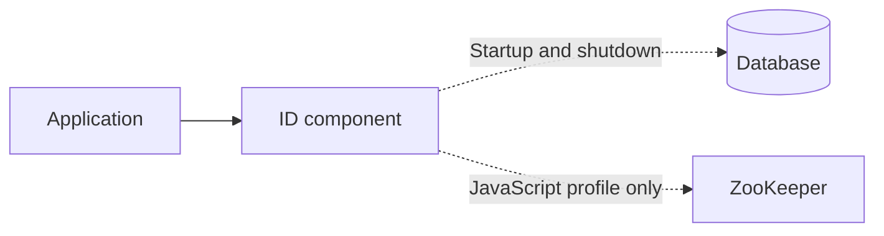

# Smartscity Starter

English · [简体中文](README.zh-CN.md)

Java / Spring Boot components. Currently: distributed IDs. Not yet released.

Local generation · Monotonic clock · Concurrent buffer · Health and metrics

## Architecture

## Quick start

1. Install locally with JDK 21: `./mvnw -DskipTests install`.
2. Keep your application's Spring Boot BOM. Add `com.smartscity:smartscity-id-spring-boot-starter:0.1.0-SNAPSHOT` and a JDBC driver.
3. Apply the matching [schema](smartscity-id-spring-boot-autoconfigure/src/main/resources/db), configure your application's DataSource and set `smartscity.id.group=orders`.
4. Inject `IdGenerator` and call `getUniqueId()`.

The JavaScript profile also requires ZooKeeper. See [configuration](docs/06-Configuration.md) and the [example](samples/id-example) for details.

## Roadmap

- [x] ID component and fault verification
- [ ] Run the performance matrix in GitHub Actions
- [ ] Complete compatibility validation and prepare the first release

## Documentation

Detailed guides are currently in Chinese.

| Topic | Links |
|---|---|
| Design | [Architecture](docs/02-System-Architecture.md) · [ID contract](docs/05-ID-Contract.md) |
| Usage | [Configuration](docs/06-Configuration.md) · [Compatibility](docs/03-Compatibility-Matrix.md) |
| Validation | [Tests](testing/TEST-INVENTORY.md) · [JMH and Actions](docs/08-Benchmark.md) |

[Documentation index](docs/00-README.md)
