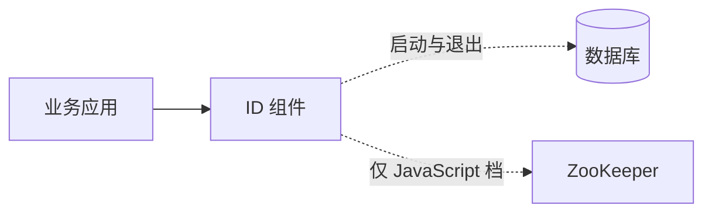

# Smartscity Starter

[English](README.md) · 简体中文

面向 Java / Spring Boot 的基础组件。当前提供分布式 ID，尚未发布。

本地发号 · 单调时钟 · 并发缓存 · 健康检查与指标

## 架构

## 快速接入

1. 使用 JDK 21 安装到本地：`./mvnw -DskipTests install`。
2. 保留应用自己的 Spring Boot BOM，添加 `com.smartscity:smartscity-id-spring-boot-starter:0.1.0-SNAPSHOT` 和 JDBC 驱动。
3. 执行对应的[建表脚本](smartscity-id-spring-boot-autoconfigure/src/main/resources/db)，配置应用 DataSource，并设置 `smartscity.id.group=orders`。
4. 注入 `IdGenerator`，调用 `getUniqueId()`。

JavaScript 档还需 ZooKeeper。详细接入见[配置](docs/06-Configuration.md)和[示例](samples/id-example)。

## 规划

- [x] ID 组件与故障验证
- [ ] 在 GitHub Actions 执行性能矩阵
- [ ] 补齐兼容验证，准备首个发布版本

## 文档

| 主题 | 入口 |
|---|---|
| 设计 | [架构](docs/02-System-Architecture.md) · [ID 契约](docs/05-ID-Contract.md) |
| 接入 | [配置](docs/06-Configuration.md) · [兼容矩阵](docs/03-Compatibility-Matrix.md) |
| 验证 | [测试清单](testing/TEST-INVENTORY.md) · [性能测试与自动执行](docs/08-Benchmark.md) |

[全部文档](docs/00-README.md)
