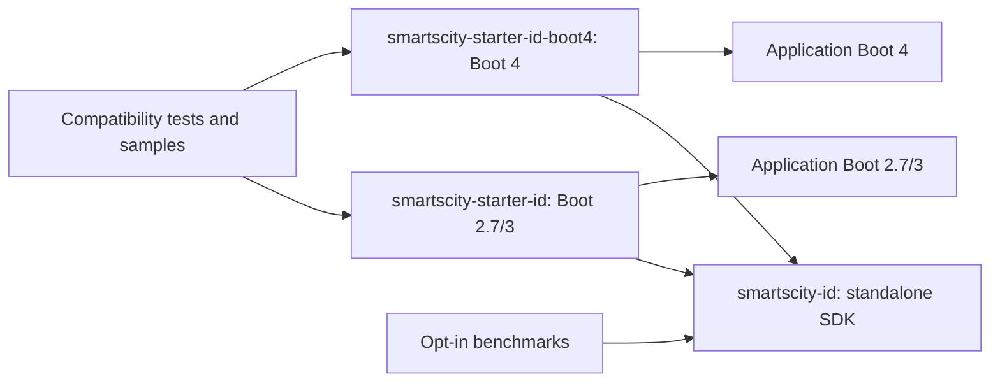

# Repository responsibilities and module boundaries

| Root | Ownership |
|---|---|
| `build/` | Published build parent and independent production-only BOM |
| `core/` | Shared infrastructure only after demonstrated reuse; no placeholder artifact |
| `module/` | Framework-independent SDKs, usable without Spring Boot |
| `starter/` | Component families containing Boot integration and starter dependencies |
| `test/` | Cross-module verification, opt-in benchmarks and historical evidence |
| `samples/` | Executable consumer applications |
| `docs/` | Global navigation/architecture and component-owned documentation |
| `.github/` | CI and explicitly dispatched delivery workflows |

A component normally needs one SDK and one combined integration/starter. Split a second generation only when framework API or runtime requirements demand it. No cache, lock or rate-limit placeholder modules exist. Domain objects own their invariants; framework entry points assemble and delegate. No Spring dependency or framework auto-configuration belongs in a standalone SDK.

ID currently has three production artifacts:

The starter paths are alternatives. Their unpublished family aggregator groups `boot2-3` and `boot4`; it is neither a runtime dependency nor the parent of published artifacts. All production children inherit `build/smartscity-parent` directly, so their published POMs resolve without the family POM. `build/smartscity-dependencies` has no parent and manages only the three production library coordinates. It never imports Boot or test dependency management. The root only aggregates the reactor.

Every module uses standard Maven source/resource/test roots. The two ID starters maintain matching generation-neutral source, resources and tests, checked by the repository gate; the health implementation is intentionally generation-specific. No `src/shared`, source injection, cross-generation runtime dependency or speculative common adapter artifact exists. This small duplication is the explicit cost of conventional, self-contained source trees. Normal source and Javadoc JARs now contain actual starter implementation.

See [ADR-0010](../adr/0010-component-families.md) for the packaging decision, [ID design](../id/README.md) for state ownership, and [ID usage](../id/USER_GUIDE.md) for the consumer path. Component compatibility, migrations and test inventories live under `docs/<component>/`; global documents provide navigation and shared policies.
