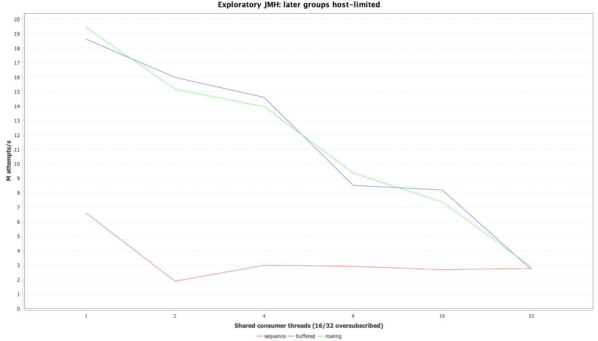
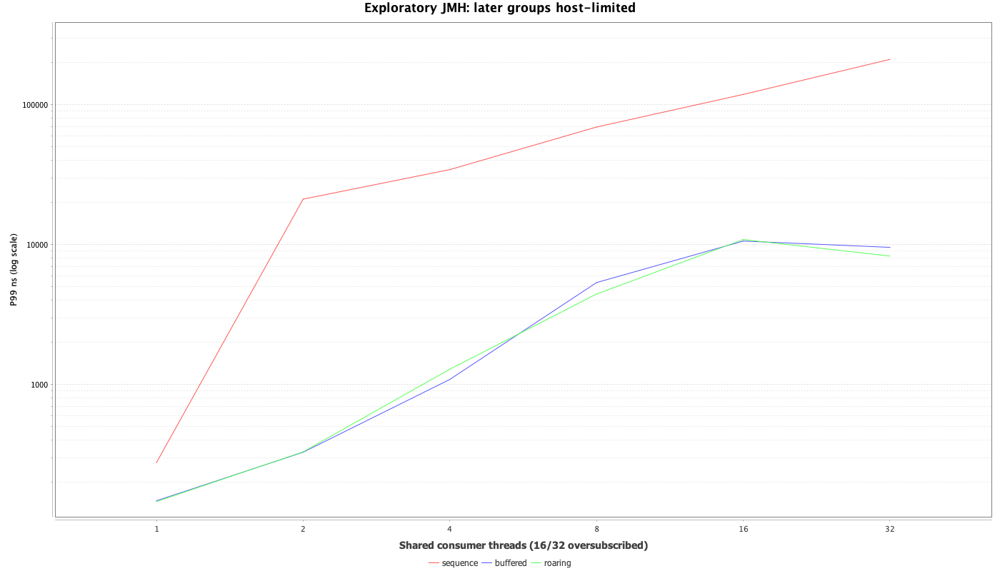
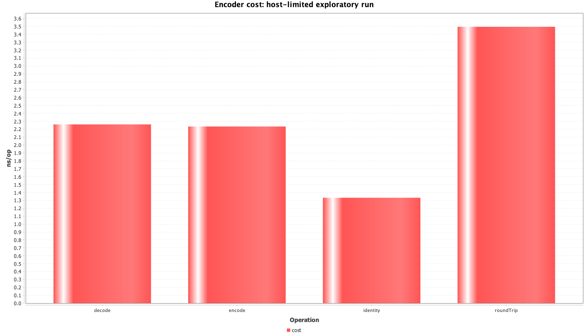
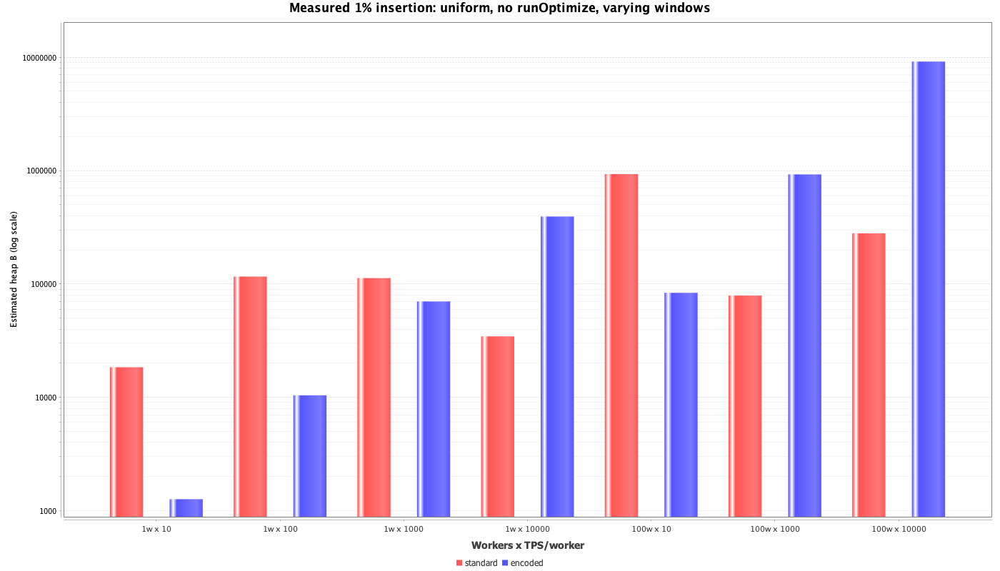
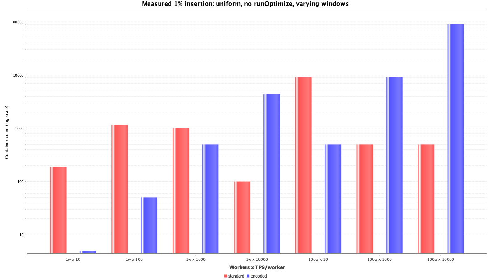
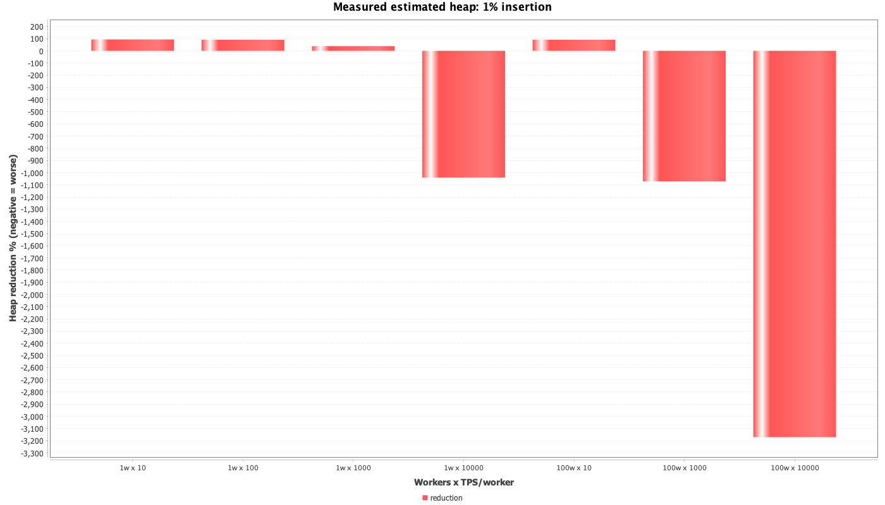
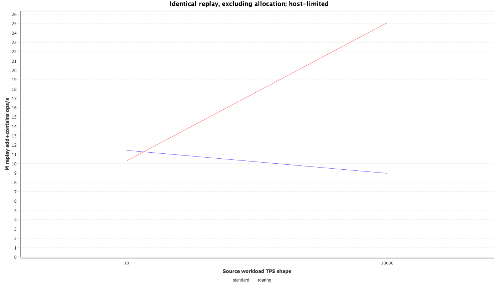

# Smartscity ID benchmark

## Generator names and Roaring storage encoding — 2026-11-04

Status: **NOT_COMPARABLE** for performance comparison; measured memory is a deterministic dataset comparison, with JVM heap explicitly estimated. JMH records: {'generator': 72, 'encoder': 8, 'bitmap': 24, 'live': 4}; expected: {'generator': 72, 'encoder': 8, 'bitmap': 24, 'live': 4}. Source unchanged: True; JAR unchanged: True. The SDK's standard protocol, ring capacity and default Boot behavior remain unchanged. No universal speedup is claimed.

The machine reported CPU limiting during later groups. One-fork, short local results below are exploratory point estimates, not a production baseline or statistically established regression/improvement. Do not rank implementations using host-limited groups. The 16/32-thread groups oversubscribe this 12-logical-core machine; independent buffered workers add producer threads as well. Even lower thread counts include GC/JMH/producer threads. Tail percentiles use SampleTime sampling and the short run does not establish a production P99.9 SLO.

Environment: Intel(R) Core(TM) i7-9750H CPU @ 2.60GHz; 6 physical/12 logical CPUs; 16 GiB RAM; macOS-26.5.1-x86_64-i386-64bit-Mach-O. Temurin Java 21.0.12.1+1; G1; -Xms256m -Xmx2g. RoaringBitmap 1.6.29, JMH 1.37, JOL 0.17. One fork, 1 x 1 s warmup, 2 x 1 s measurement, GC profiler. This intentionally deviates from the recommended 3 forks, 5 x 5 s warmup and 10 x 5 s measurement. Invocation setup is outside the timed live-pipeline method but may contribute profiler allocation/GC. CPU utilization, process RSS and exact retained heap are UNAVAILABLE.

Measured source base commit: `2d3f4be5917232f7b846bb163c2d7e13b05b6511` with the task's working changes. Frozen benchmark JAR SHA-256: `78511b9b47e2c3a39a134db55af28cf32a7c0bb64651145108424a69d7fa2b47`. [Environment and source fingerprints](../../test/smartscity-id-benchmark/roaring/results/environment.json) bind these measurements to source contents, not just the base commit.

Validation: 198 reported tests, 165 executed, 33 conditional skips, 0 failures, 0 errors. Java 21 reactor verification and production artifact boundaries passed. External database/fault skips are not claimed as executed. The encoder tests check every bit, v1 golden vectors, boundary/random round trips and concurrent lifecycle behavior; the storage driver checks cardinality, membership and deletion before reporting results.

## Table A — Generator performance

Throughput is attempted calls; failure counts are retained separately. Avg/P99 come from a separate SampleTime run, not throughput reciprocal. Alloc B/op comes from the throughput GC profiler. Outcomes from different modes must not be merged. Both shared and independent instances use safe distinct Worker fixtures; no database registration is timed.

| Generator | Ownership | Threads | Throughput M attempts/s | Sample mean ns | P99 ns | Alloc B/op | Throughput timeouts (count) |
|---|---|---:|---:|---:|---:|---:|---:|
| buffered | independent | 1 | 19.49 | 98.89 | 149.00 | 0.0004 | 0 |
| roaring | independent | 1 | 19.30 | 105.07 | 149.00 | 0.0004 | 0 |
| sequence | independent | 1 | 6.50 | 208.10 | 223.00 | 0.0012 | 0 |
| buffered | independent | 2 | 22.42 | 177.30 | 247.00 | 0.0004 | 0 |
| roaring | independent | 2 | 21.76 | 169.51 | 257.00 | 0.0004 | 0 |
| sequence | independent | 2 | 7.64 | 389.17 | 537.00 | 0.0012 | 0 |
| buffered | independent | 4 | 30.07 | 253.36 | 698.00 | 0.0003 | 0 |
| roaring | independent | 4 | 29.57 | 247.39 | 443.00 | 0.0004 | 0 |
| sequence | independent | 4 | 10.07 | 517.73 | 684.00 | 0.0011 | 0 |
| buffered | independent | 8 | 33.25 | 574.50 | 1,248.00 | 0.0004 | 0 |
| roaring | independent | 8 | 33.49 | 470.47 | 986.00 | 0.0004 | 0 |
| sequence | independent | 8 | 12.21 | 1,007.51 | 1,764.00 | 0.0013 | 0 |
| buffered | independent | 16 | 30.52 | 2,803.40 | 1,538.00 | 0.0007 | 0 |
| roaring | independent | 16 | 32.18 | 1,931.92 | 1,160.00 | 0.0007 | 0 |
| sequence | independent | 16 | 12.87 | 3,524.37 | 2,012.00 | 0.0019 | 0 |
| buffered | independent | 32 | 28.13 | 4,583.44 | 1,200.00 | 0.0013 | 0 |
| roaring | independent | 32 | 34.10 | 5,113.12 | 1,234.00 | 0.0107 | 3 |
| sequence | independent | 32 | 13.25 | 9,942.71 | 2,076.00 | 0.0030 | 0 |
| buffered | shared | 1 | 18.62 | 104.83 | 148.00 | 0.0004 | 0 |
| roaring | shared | 1 | 19.44 | 92.71 | 146.00 | 0.0004 | 0 |
| sequence | shared | 1 | 6.61 | 221.32 | 277.00 | 0.0012 | 0 |
| buffered | shared | 2 | 15.97 | 206.53 | 329.00 | 0.0005 | 0 |
| roaring | shared | 2 | 15.16 | 210.27 | 331.00 | 0.0006 | 0 |
| sequence | shared | 2 | 1.90 | 1,427.75 | 21,152.00 | 2.6226 | 0 |
| buffered | shared | 4 | 14.60 | 351.99 | 1,090.00 | 0.0007 | 0 |
| roaring | shared | 4 | 13.96 | 388.95 | 1,290.00 | 0.0008 | 0 |
| sequence | shared | 4 | 3.00 | 2,446.95 | 34,368.00 | 1.8744 | 2 |
| buffered | shared | 8 | 8.52 | 1,077.17 | 5,360.00 | 0.0019 | 0 |
| roaring | shared | 8 | 9.37 | 1,154.93 | 4,440.00 | 0.0016 | 0 |
| sequence | shared | 8 | 2.92 | 4,636.58 | 69,248.00 | 1.9078 | 0 |
| buffered | shared | 16 | 8.20 | 5,980.61 | 10,608.00 | 0.0099 | 131 |
| roaring | shared | 16 | 7.37 | 5,644.57 | 10,880.00 | 0.0124 | 154 |
| sequence | shared | 16 | 2.69 | 8,730.74 | 118,400.00 | 1.8386 | 30 |
| buffered | shared | 32 | 2.71 | 11,908.01 | 9,568.00 | 0.5203 | 3,161 |
| roaring | shared | 32 | 2.89 | 10,034.32 | 8,288.00 | 0.4968 | 3,200 |
| sequence | shared | 32 | 2.78 | 14,889.37 | 210,688.00 | 1.7171 | 0 |

## Table B — Encoder performance

Changing arrays are prepared before measurement. Values are consumed; no generation is included. Full throughput, round-trip cost and allocation results are in jmh.csv. Encode versus identity is the relevant incremental CPU comparison, but host variation and one fork prevent a precise overhead guarantee.

| Encoder | Encode ns/op | Decode ns/op | Alloc B/op |
|---|---:|---:|---:|
| IdentityIdEncoder | 1.33 | 1.33 | 0.00001 |
| RoaringIdEncoder | 2.23 | 2.26 | 0.00002 |

## Table C — Bitmap memory (measured, estimated JVM heap)

Identical logical IDs and insertion selection, seed 711. All four configurations are measured. The table shows uniform 100% and 1% cases; 10%, burst cases, all container types and timing/GC columns are in [memory.csv](../../test/smartscity-id-benchmark/roaring/results/memory.csv). Windows vary to keep the experiment bounded; compare within a row, not across differently sized workloads. The steady allocation fixture uses the standard formula, not actual distributed scheduling.

| Workers | TPS/worker | Ratio | Window s | Stored IDs | runOptimize | Original heap B | Encoded heap B | Reduction % | Original containers | Encoded containers |
|---:|---:|---:|---:|---:|---|---:|---:|---:|---:|---:|
| 1 | 10 | 1.00 | 1800 | 18000 | false | 213,320 | 41,648 | 80.48 | 1800 | 5 |
| 1 | 10 | 1.00 | 1800 | 18000 | true | 170,120 | 728 | 99.57 | 1800 | 5 |
| 1 | 10 | 0.01 | 1800 | 199 | false | 18,440 | 1,264 | 93.15 | 189 | 5 |
| 1 | 10 | 0.01 | 1800 | 199 | true | 18,440 | 1,264 | 93.15 | 189 | 5 |
| 1 | 100 | 1.00 | 1800 | 180000 | false | 674,120 | 414,760 | 38.47 | 1800 | 50 |
| 1 | 100 | 1.00 | 1800 | 180000 | true | 170,120 | 5,560 | 96.73 | 1800 | 50 |
| 1 | 100 | 0.01 | 1800 | 1843 | false | 116,128 | 10,408 | 91.04 | 1164 | 50 |
| 1 | 100 | 0.01 | 1800 | 1843 | true | 116,128 | 10,408 | 91.04 | 1164 | 50 |
| 1 | 1000 | 1.00 | 1000 | 1000000 | false | 2,277,680 | 2,177,368 | 4.40 | 1000 | 500 |
| 1 | 1000 | 1.00 | 1000 | 1000000 | true | 93,680 | 45,368 | 51.57 | 1000 | 500 |
| 1 | 1000 | 0.01 | 1000 | 9957 | false | 112,680 | 70,056 | 37.83 | 1000 | 500 |
| 1 | 1000 | 0.01 | 1000 | 9957 | true | 112,680 | 70,056 | 37.83 | 1000 | 500 |
| 1 | 10000 | 1.00 | 100 | 1000000 | false | 828,432 | 2,564,712 | -209.59 | 100 | 5000 |
| 1 | 10000 | 1.00 | 100 | 1000000 | true | 10,032 | 444,712 | -4332.93 | 100 | 5000 |
| 1 | 10000 | 0.01 | 100 | 9957 | false | 34,480 | 393,352 | -1040.81 | 100 | 4330 |
| 1 | 10000 | 0.01 | 100 | 9957 | true | 34,480 | 393,352 | -1040.81 | 100 | 4330 |
| 100 | 10 | 1.00 | 1000 | 1000000 | false | 8,199,208 | 2,191,088 | 73.28 | 50000 | 500 |
| 100 | 10 | 1.00 | 1000 | 1000000 | true | 5,399,208 | 59,088 | 98.91 | 50000 | 500 |
| 100 | 10 | 0.01 | 1000 | 9957 | false | 931,360 | 83,552 | 91.03 | 9124 | 500 |
| 100 | 10 | 0.01 | 1000 | 9957 | true | 931,360 | 83,552 | 91.03 | 9124 | 500 |
| 100 | 1000 | 1.00 | 10 | 1000000 | false | 2,186,592 | 7,282,032 | -233.03 | 500 | 50000 |
| 100 | 1000 | 1.00 | 10 | 1000000 | true | 54,592 | 4,482,032 | -8110.05 | 500 | 50000 |
| 100 | 1000 | 0.01 | 10 | 9957 | false | 79,040 | 925,480 | -1070.90 | 500 | 9085 |
| 100 | 1000 | 0.01 | 10 | 9957 | true | 79,040 | 925,480 | -1070.90 | 500 | 9085 |
| 100 | 10000 | 1.00 | 10 | 10000000 | false | 4,146,592 | 73,096,696 | -1662.81 | 500 | 500000 |
| 100 | 10000 | 1.00 | 10 | 10000000 | true | 54,592 | 45,096,696 | -82506.78 | 500 | 500000 |
| 100 | 10000 | 0.01 | 10 | 99943 | false | 279,768 | 9,149,896 | -3170.53 | 500 | 91007 |
| 100 | 10000 | 0.01 | 10 | 99943 | true | 279,768 | 9,149,896 | -3170.53 | 500 | 91007 |

JOL graph traversal fell back to estimated 64-bit HotSpot layouts (compressed references, 8-byte alignment). getSizeInBytes in Roaring 1.6.29 casts serialized size to int; serializedBytes is the long representation. Neither equals JVM retained heap. Peak pool sums are not exact simultaneous peaks or Bitmap-only memory. runOptimize timing and before/after heap are recorded, with exclusive mutation; peak observations include other process objects. No memory advantage implies lower GC latency or faster recovery without application measurements.

## Table D — Storage and end-to-end performance

The replay pipeline uses identical source arrays and excludes allocation; the live pipeline separately includes actual BufferedIdGenerator calls on identical fixed-clock prefixes. This separates workload-shape comparison from live generation. Add/replay P99 values normalize whole 10,000-ID batches and are not per-request tail latency. Contains percentiles are individual existing-key lookups; absence lookup is not measured. All Bitmap mutation is single-writer.

| TPS | Encoding | Add ops/s | Contains ops/s | Replay ops/s | Replay amortized P99 ns | Replay alloc B/ID |
|---:|---|---:|---:|---:|---:|---:|
| 10 | standard | 15,800,698 | 33,335,406 | 10,308,975 | 121.54 | 121.72 |
| 10 | roaring | 24,079,736 | 16,024,884 | 11,423,654 | 149.68 | 128.59 |
| 10000 | standard | 44,408,497 | 125,821,643 | 25,091,198 | 56.00 | 76.58 |
| 10000 | roaring | 12,277,219 | 34,980,550 | 8,960,072 | 208.80 | 166.52 |

| Live pipeline | Throughput ops/s | Sample mean ns/ID | Amortized P99 ns/ID |
|---|---:|---:|---:|
| standard | 9,765,119 | 107.55 | 164.00 |
| roaring | 6,493,638 | 145.86 | 185.28 |

## Retention model (not measured)

[modeled.csv](../../test/smartscity-id-benchmark/roaring/results/modeled.csv) covers all 7 worker/rate pairs, 100/10/1% insertion, uniform and 10-second bursts, and 30 minutes/1 day/7 days/30 days. Source IDs use standard steady timestamps; workers 0..99 are paired for original containers. For each candidate container with n original values, expected occupancy is `1-(1-p)^n` and expected cardinality is `n*p`. Original high keys are `(t,w>>>1)`; encoded keys are `(w,t>>>15,s>>>1)`. The model counts those bucket populations before applying selection. Startup-cache transients, worker churn and correlated business failures are not included.

Heap uses 96 B amortized ART/directory overhead plus a 24 B container and aligned 16 B array header. Array growth is approximated at conditional mean cardinality using the library's capacity steps; bitmap payload is 8192 B above 4096 entries. This is not an exact expectation near conversion thresholds. Modeled runOptimize is NOT_MODELED; do not extrapolate its measured benefit indiscriminately. Full models include bytes/ID and reduction; billion-ID cases were not materialized.

## Interpretation and deployment

Use the identity/standard path for database keys and general identifiers. The optional permutation has no additional allocation resource and does not alter default buffered generation. Prefer encoding existing business IDs in Bitmap storage. It can strongly reduce sparse low-TPS container overhead over long enough windows, but high-TPS short windows may spread sequence pairs into many encoded containers and consume more memory; the table preserves those negative reductions. runOptimize often makes standard consecutive runs extremely compact. CPU cost, insertion locality and collection size must be weighed together; no universal winner is established.

Keep business-time retention windows, explicit encoding-version metadata and coordinated snapshot migration. Do not silently reinterpret existing Bitmap keys, mix encoding versions, or allocate a second unrelated ID for one business entity. Numeric time ordering changes; uniqueness still depends on safe worker registration. Raft state machines must apply deterministic same-version encoding across replicas; Raft itself is not an in-memory database. See [design](README.md#generator-implementations-and-storage-encoding), [usage](USER_GUIDE.md#roaring-oriented-storage) and [direct commands](../../test/smartscity-id-benchmark/USER_GUIDE.md#generator-encoder-and-bitmap-comparison).

## Charts

All plotted performance numbers are raw exploratory observations, including host-limited groups; charts are not a validated ranking. Memory plots show measured estimated heap; modeled values are kept in a separate CSV.

## Host issues and evidence

- generator-16-thrpt after: CPU_Speed_Limit=77%
- generator-16-sample before: CPU_Speed_Limit=77%
- generator-16-sample after: CPU_Speed_Limit=88%
- generator-32-thrpt before: CPU_Speed_Limit=88%
- generator-32-thrpt after: CPU_Speed_Limit=82%
- generator-32-sample before: CPU_Speed_Limit=82%
- generator-32-sample after: CPU_Speed_Limit=88%
- encoder-thrpt before: CPU_Speed_Limit=88%

[Execution commands and observations](../../test/smartscity-id-benchmark/roaring/results/execution.json), [JMH compact CSV](../../test/smartscity-id-benchmark/roaring/results/jmh.csv), [lossless raw JMH archive](../../test/smartscity-id-benchmark/roaring/results/jmh-raw.zip), [validation counts](../../test/smartscity-id-benchmark/roaring/results/validation.json). Earlier Baidu comparison and sampling work used different frozen snapshots; its numbers are not a baseline for this feature.
