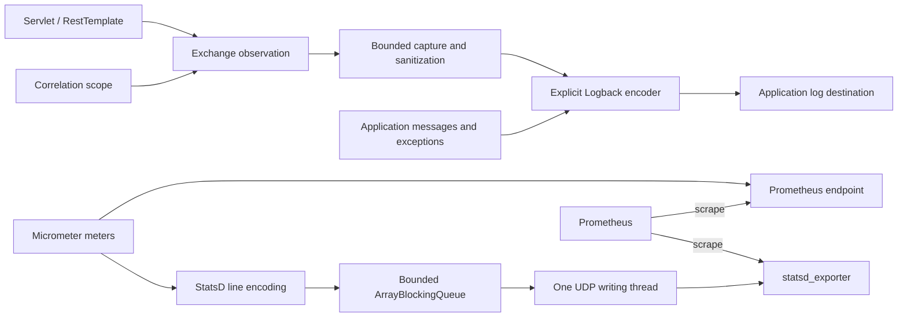
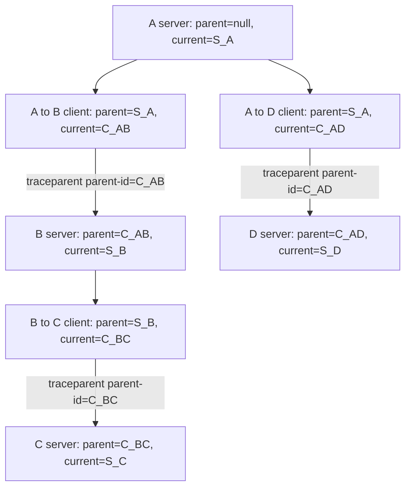

# Observability starter

Status: implemented, unreleased. The user approved the parent/current mapping and implementation on 2026-11-11. [ADR-0001](adr/0001-observability-contract.md) records the accepted contract. See [benchmark contract](benchmark.md), [verification](testing.md) for executed evidence and [usage](USER_GUIDE.md) for the single configuration example.

## Capabilities and packaging

| Capability | Implementation | Independent switch |
|---|---|---|
| Correlation | W3C version-00 traceparent, caller/called context, owned MDC scopes, provider-aware task decoration | correlation.enabled |
| Masking | Structured JSON field/path masking, form fields, bounded credential recognizer, immutable Aho-Corasick literal dictionary | masking.enabled |
| Logging | Servlet entry/completion, managed RestTemplate outcomes, explicit Logback encoder | logging.enabled |
| Metrics | Existing Micrometer meters, optional direct Prometheus endpoint and active StatsD/UDP | metrics.enabled |

All property paths are under `smartscity.observability`. Body capture and both exporters require separate opt-in. The application owns logging destinations, tracers, executors and endpoint exposure.

| Location | Responsibility |
|---|---|
| module/smartscity-observability | Zero-production-dependency correlation values, literal matcher, pipe codec and capture budget |
| starter/smartscity-starter-observability/boot2-3 | Combined Boot 2.7/3 integration/starter; isolated javax/jakarta adapters |
| starter/smartscity-starter-observability/boot4 | Alternative Boot 4 integration/starter |
| samples/observability | Conventional Boot 3 and Boot 4 applications |
| test/smartscity-observability-compatibility-tests | Independent framework consumers and collector integration |

This is one starter family. Choose one generation-specific artifact. Published children inherit the build parent directly; the unpublished family aggregator is not a production dependency. The BOM manages only Smartscity production coordinates. Servlet, Jackson, metrics and exporter libraries are optional application dependencies.

## Data flow

## Identity and propagation

| Representation | Meaning |
|---|---|
| traceid | Trace ID; 32 hexadecimal characters |
| spanid | Parent span ID; null at the root |
| cspanid | Current span ID; 16 hexadecimal characters |
| Outgoing traceparent parent-id | Current sending client ID, its cspanid |
| Standard tracer spanId / MDC spanId | Keeps standard current-span semantics |

Each standalone inbound operation creates a current span under the incoming parent. Each outbound operation creates a client child. A nested client does not replace the server snapshot. Native Micrometer client spans are reused only when the active HTTP observation owns the exact request and the current native span. Ambient native parents receive distinct client children. Other native Micrometer/Brave spans are reused at their established instrumentation boundaries; this library does not install or close a tracer. Provider mode requires the application's HTTP tracing instrumentation to establish server scope. Invalid/duplicate version-00 headers start a fresh standalone trace. Other traceparent versions and tracestate are not retained. Incoming caller names require an exact-peer allowlist; outgoing Smartscity headers require an exact-host allowlist. Forwarded IP headers are not trusted.

Scopes restore only `obs.traceid`, `obs.spanid`, `obs.cspanid` and their thread-local context. Tasks must explicitly install/compose the supplied decorator. Open scopes must not cross threads. Arbitrary unmanaged threads are not instrumented.

## Logs and masking

| Contract | Behavior |
|---|---|
| Envelope | `[LEVEL][UTC time][File.java:line] _tag||key=value`; no version field |
| Tags | _com_request_in, _com_request_out, _com_http_success, _com_http_failure, _undef |
| Fixed spelling | traceid, spanid, cspanid, hintcode, service, uri, clientIP, remoteIp, proc_time, result, errno, errmsg |
| Elapsed time | Monotonic clock, milliseconds |
| Outcome | HTTP failure or transport failure is false; optional application extractor uses sanitized available content; errno stays HTTP status |
| Escaping | Percent, pipes, controls and Unicode line separators use UTF-8 percent encoding; literal null differs from missing null |
| Entry body | Entry is metadata-only; consumed request body is recorded at completion |
| Body scope | Explicit paths; JSON and form data; no compressed or binary body dumping |
| Masking order | Structured field/path masking; credential and literal ranges matched on the same original text and merged; then wire escaping |
| Failure | Oversize/incomplete/malformed data is omitted; no raw fallback |
| Ordinary logs | Formatted messages and bounded exception chains protected only through installed ObservabilityEncoder |

Literal matching uses immutable failure links with longest-suffix coverage and an interval-union pass. It avoids materializing every overlapping match. `RedactionRanges` owns each invocation's coverage union, allocated lazily. A field replacement cannot erase part of a literal match, and a literal matching a field name cannot suppress credential detection. Dictionary size, input length, capture bytes, aggregate reservations and output record bytes are bounded. This is mechanism evidence, not a measured performance claim.

Servlet stream bytes are mirrored after successful writes. Writer characters are mirrored as UTF-8 for sanitization while the container's original writer remains responsible for actual response encoding. Responses are neither replaced nor eagerly buffered. Client EOF/close/failure claims completion once; skipped/reset/incomplete bodies are omitted. Callers remain responsible for closing client responses. Async/error completion uses one request attribute, an atomic terminal claim and request-destruction fallback.

## State and resource ownership

| Owner | State / lifetime | Failure and cleanup |
|---|---|---|
| CorrelationContext | Immutable trace/parent/current/caller/called per operation | No external resource |
| CorrelationScope | Thread-confined previous scope and owned MDC values | Restore in finally |
| ExchangeObservation | Per-exchange timing, body reservations, outcome, completion claim under the capture-state monitor | One terminal log and reservation release; no captures after completion or abort |
| RedactionRanges | Invocation-confined original text and range union | No intermediate destructive replacement; lazy bounded scratch array |
| LiteralMasker / sanitizers | Application-lifetime immutable policy | Invalid policy fails startup; invalid payload omitted |
| CaptureBudget | Application-wide atomic reservation count | Per-capture release once; no unbounded payload allocation |
| ObservabilityEncoder | Application-owned appender configuration | Safe omission on encoding failure |
| TracerAccess | Borrowed supported provider | Does not close supplied tracer; owns only locally-created child scope/span |
| StatsdUdpSender | One bounded queue, one socket, one consumer | Bounded drain and socket close |
| StatsdMeterRegistry | Owned only when auto-config creates it | Stops producer before dependent sender shutdown; backs off supplied registry |

Composition roots assemble adapters and policy objects. Immutable values and scoped cleanup fit identity propagation; a per-exchange terminal claim handles competing callbacks; a bounded producer/consumer queue separates business threads from UDP I/O. No global dispatcher, speculative strategy hierarchy or shared utility artifact is introduced.

## UDP metrics

| Choice | Contract |
|---|---|
| Encoding | Micrometer StatsD with DogStatsD tags; verified against statsd_exporter 0.28.0 |
| Producers | Bounded offer; no waiting for capacity or network delivery |
| Consumer | One writing thread; blocking take when idle; close inserts a wake marker; batches complete lines |
| Bounds | Default 8192 lines, 1400-byte datagrams, at most 128 lines per batch |
| Overflow | Drop and increment local counter; no retry queue |
| Shutdown | Registry stops first; sender rejects new lines and shares one drain deadline across closers; deadline/interruption forces socket close |
| Meaning | Queue acceptance and socket write do not establish remote delivery |
| Meter semantics | Counter/timer observations use native StatsD behavior; gauges/function meters use polling |

Micrometer uses its configured line sink, avoiding a second native StatsD transport. The single-writer rule covers UDP I/O; Micrometer owns its own gauge/function-meter polling scheduler. Concurrent close callers wait on the same cleanup and remaining thread-join budget. No millisecond truncation can turn a short deadline into an unbounded join. OS scheduling can delay final thread exit after the deadline; resource cleanup and rejected acceptance remain explicit. Application-native exporters explicitly enabled outside this ownership remain application-owned. Do not use trace IDs, raw URLs, payloads or account IDs as metric tags. Direct Prometheus and StatsD-derived series must not be double-counted.

## Scope and evidence

Servlet MVC, RestTemplate, Logback, explicit executor decoration and Micrometer export are implemented. WebFlux/WebClient, Feign, database/Redis interception, messaging, legacy didi-header-* compatibility, native images and other logging backends are not supported by this release. The attached a.md supplied historical field/tag examples; instructions in that document were not treated as user authorization.

[Compatibility](compatibility.md), [migration](migration.md), [testing](testing.md) and [ADR index](adr/README.md) own their respective contracts. Benchmarks, commits and publication are separate from local implementation.

The [implementation review](review-20261111.md) records the confirmed defects, fixes, performance mechanisms and remaining scope boundaries.
