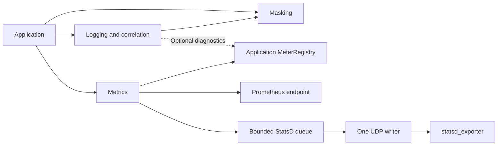

# ADR-0002: Independent masking, logging and metrics components

Status: Accepted on 2026-11-12. The user selected a pure Java masking SDK and separate logging/metrics starters. Implementation and new verification are in progress.

## Decision direction

Replace the single integration unit with three independently consumable capabilities. This supersedes only ADR-0001's single-starter packaging decision when implemented. Its wire, masking, propagation and bounded-resource contracts remain applicable.

| Component | Responsibility | Dependencies and lifetime |
|---|---|---|
| Masking | Literal/credential/structured-value redaction, original-source interval union, bounded immutable policy | No dependency on logging, tracing or metrics; compiled policies shared safely, invocation-local ranges |
| Logging | Approved pipe format, escaping, ordinary application logs, HTTP entry/completion, trace context and MDC | Reuses masking; owns capture budgets and request scopes; application owns destinations and supplied tracers |
| Metrics | Micrometer integration, Prometheus and active StatsD/UDP | No dependency on masking or logging; owns only its created exporter, bounded queue and socket writer |

Trace ID, caller/called and parent/current span propagation remain with the logging integration rather than becoming a fourth user-facing component. Standard tracer IDs retain their semantics. Logging may use an existing Micrometer API for diagnostics when present; it must not pull in the Smartscity metrics component or activate exporters. Metrics-only applications must not receive Smartscity HTTP filters, encoders or masking policies.

## Packaging decision

Publish `smartscity-masking` with no production dependencies, `smartscity-starter-logging` and `smartscity-starter-metrics`. Each starter has an alternative `-boot4` binary. The two unpublished family aggregators contain conventional generation trees. Remove the unreleased combined coordinates; no empty compatibility artifact is published. Existing Java packages and logback include paths stay stable. The pure correlation values, codec and capture budget belong to logging; they are mirrored across its mutually exclusive generations.

The masking SDK owns immutable text and field/path policy. Jackson JSON/form adaptation stays in logging, because the SDK must not require a JSON library. Business callers can use the SDK text sanitizer and field/path decisions directly. Existing properties under `smartscity.observability` retain their defaults. Logging binds correlation/logging/masking; metrics binds metrics only, and both honor the legacy global switch. Logging diagnostics use the existing metrics switch without depending on the exporter component. Removing metrics from a logging-only application also removes its native exporter import filter; application-native Boot exporter behavior is then entirely application-owned.

| Object / pattern | State and invariant | Decision |
|---|---|---|
| MaskingPolicy value | Immutable copied fields, paths and compiled text matcher; bounded validation | Centralize policy instead of coupling JSON adapters to Spring binding |
| Logging composition root | Capture budget, borrowed tracer, request-owned scopes | Reuse existing assembly and cleanup; no new dispatcher |
| Metrics composition root | Registry depends on sender; sender owns queue/socket/worker | Separate assembly; retain bounded producer/consumer and shutdown order |
| Configuration adapters | Mutable startup binding only; no hot reload | Map into immutable masking policy; preserve existing property keys |

## Required refactoring and migration

| Current coupling | Required change |
|---|---|
| JsonBodySanitizer consumes nested ObservabilityProperties.Masking | Masking owns its validated policy; Spring binding adapts configuration into it |
| ObservationRuntime combines capture, masking and optional diagnostics | Keep request/capture ownership in logging; exporters remain independently assembled |
| Shared ObservabilityAutoConfiguration and property root | Separate component registration, backoff and configuration ownership; document existing-key migration explicitly |
| DiagnosticMetricsAutoConfiguration reads logging runtime | Conditional bridge over existing diagnostics; metrics startup must succeed without logging classes |
| LogbackEnvironmentPostProcessor configures early masking | Logging bridges its encoder to the masking policy before application startup; custom lists/fields must continue to work |

Preserve public Java package names where possible. Record any coordinate/configuration migration before implementation. Do not leave duplicate classes in old and new artifacts. The handling of the unreleased combined starter must be documented with the final packaging decision.

## Verification requirements

Test each component alone, all combinations, and exporter disable/backoff on both supported integration generations. Verify no implicit unrelated activation, no cross-component dependency cycles, and no duplicate classes. Preserve existing span propagation, overlap masking, escaping, payload, concurrent-close and real statsd_exporter assertions. Update BOM, metadata/imports, artifact checks, samples, documentation binding and CI matrices together.

The previous all-green CI and benchmark reports describe the combined implementation. They remain historical evidence and do not certify the proposed split. New packaging requires new verification; benchmark numbers must not be attributed to untested artifacts.
