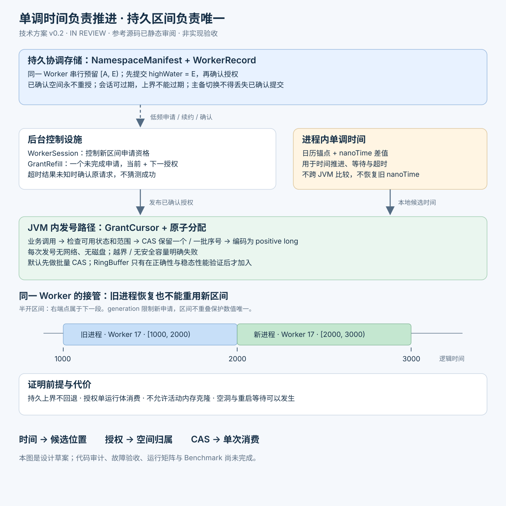

> 历史提案，已被用户要求收敛；不作为当前设计依据。当前见[简版方案](../README.md)。

# 分布式唯一 ID 技术方案 v0.2

状态：`IN_REVIEW`。日期：2026-10-24（Asia/Singapore）。本文件为本次完整技术方案草案的 owning 文档，未批准、未实现、未运行功能测试或 Benchmark。

用户本轮要求：结合八年前的参考实现，重新考虑时间回拨、可证明唯一性、故障恢复、Worker 生命周期、可观测性与稳态性能，先给完整方案，再落地。本轮合并呈现领域、架构、契约、分期与验收，不把完整草案当成批准。

**已取得参考源码并完成发号、Worker、预填充和装配关键路径的静态审阅。** iCloud 提供的 longhub 版本下载 48/48 文件，其中 38 个 Java 文件；原先两个本地目录为空的结论仍成立。来源、逐文件哈希及源码行号见[参考材料核验与审计](../legacy-input-audit.md)。没有构建或运行旧工程，不能据此宣称线上故障已复现。

用户已确认：新格式独立设计、旧 ID 保持原样；部署覆盖 Kubernetes 与固定物理机；默认依赖 MySQL，评估以配置切换 TiDB/PostgreSQL；需要支持单台物理机 10 万业务 TPS。版本 0.2 已据此修订格式、数据库接入及容量方案。

## 1. 推荐结论与适用假设

建议采用：**单调时间推进 + 持久化、不重叠的时间区间授权 + JVM 内原子序列分配 + 后台预取下一授权区间**。

保留用户提出的本地发号、提前准备和降低缓存/并发开销三个方向。将正确性基础放在明确的 ID 空间所有权上，再通过实测决定是否增加完整 ID 的 RingBuffer 预生成。

推荐设计的前提是：仍需要正数 long、可解析的近似时间和 Worker 字段；允许启动及低频补充授权访问一个可靠协调存储；业务请求的单次发号路径不访问网络或磁盘。如果实际上只要求唯一 long、并不需要时间字段，第 3 节的纯号段方案更简单，应优先重新比较。

当前建议先交付一种受管生产模式、一种位布局和 MySQL JDBC 适配；TiDB/PostgreSQL 使用内置方言逐个验收，不要求使用方开发数据库 SPI。不要同时做静态、JDBC、Redis、ZooKeeper、etcd 全家桶。现有 API / SPI / Core / AutoConfigure / Starter 分层继续使用；本轮不修改 POM 或创建新实现模块。

参考实现的关键发现进一步支持这一取舍：

- Worker 原始数据库 ID 被模 `(2^workerBits - 1)` 压缩；可选 ZooKeeper 的先查列表再按原始 ID 注册，不能原子保证编码后 Worker 独占。
- RingBuffer.take 以过时游标快照判断领取结果；两个消费者在空队列边界存在返回同槽位的静态反例。
- 缓存发号使用秒级计数并不断借用未来秒；SDK 默认 30/18/15 布局每逻辑秒 32768 个位置，100k IDs/s 持续负载会加快时间消耗。它不是已经证明接近真实时间的 100k/s 能力。

完整交错和对应行号见[静态审计 L-01～L-04](../legacy-input-audit.md)。本稿保留性能目标，重新建立空间所有权、原子领取和恢复边界。



## 2. “CPU 时钟”到底能解决什么

| 概念 | 用途 | 能否单独证明分布式唯一 |
|---|---|---|
| `System.currentTimeMillis()` | 读取日历时间；可能受到系统校时影响 | 不能 |
| `System.nanoTime()` | 同一 JVM 内的经过时间、等待和超时 | 不能；不能作为跨 JVM 或重启后的持久时间坐标 |
| `ThreadMXBean` CPU time | 线程实际消耗的 CPU 时间 | 不适合推进发号时间；线程不运行时与真实经过时间不同 |
| CPU TSC / 平台计数器 | JVM/OS 可能使用的底层计时设施 | 不作为可移植 Java 产品的直接依赖 |
| 持久化授权上界 | 跨进程记录已分配的 ID 空间 | 配合不重叠授权、原子游标与持久性假设，构成唯一性证明 |

Java 明确规定 `nanoTime()` 的原点是任意的，同一 JVM 内的差值才有意义；纳秒单位也不等于纳秒分辨率。[Java System 文档](https://docs.oracle.com/en/java/javase/21/docs/api/java.base/java/lang/System.html#nanoTime())

CPU 使用时间与经过时间不同，[ThreadMXBean](https://docs.oracle.com/en/java/javase/21/docs/api/java.management/java/lang/management/ThreadMXBean.html#getCurrentThreadCpuTime()) 定义的是线程执行消耗。我们需要的是单调经过时间，不是“线程用了多少 CPU”。

在 Linux 上，`CLOCK_MONOTONIC`、`CLOCK_MONOTONIC_RAW`、`CLOCK_BOOTTIME` 对校频与 suspend 的语义有区别；Java 公共 API 不承诺永远映射到某一种底层实现。不能笼统声称 `nanoTime` 完全不受 NTP 校频、宿主机暂停或虚拟化影响。[内核时间文档](https://docs.kernel.org/core-api/timekeeping.html)、[KVM 时间文档](https://docs.kernel.org/virt/kvm/x86/timekeeping.html)

**结论：采用 `nanoTime()` 是正确的方向，但它只承担进程内推进，不承担跨重启和 Worker 重用的唯一性证明。** 不直接访问 RDTSC，不引入 JNI、Unsafe 或 JDK 内部类；也不要求关闭生产 NTP。

## 3. 备选方案与取舍

| 方案 | 优点 | 关键限制 | 本次建议 |
|---|---|---|---|
| 静态 Worker + 墙钟 Snowflake | 简单、运行时无需协调存储 | 重复 Worker、时钟回拨、同毫秒重建需要额外保证 | 不作为默认企业生产模式 |
| 静态 Worker + 单调时间 | 当前 JVM 不跟随墙钟倒退 | 重启原点、节点重用仍未解决 | 不单独采用 |
| Worker 租约 + fencing token | 明确身份接管与续约 | token 不进入 ID、消费者不验证时，不能消除旧进程已发 ID 冲突 | 用于控制面，不能作为全部证明 |
| 每次启动永久分配新 Worker | 不复用身份时证明直观 | Worker 位空间有限；禁止简单取模重用 | 不作为长期默认方案 |
| 全局 long 号段 + 本地游标 | 不依赖时间唯一；证明简单；无需将 Worker 编入 ID | 无精确时间解码，跨进程也不严格全局递增 | 若不需要时间字段，优先考虑 |
| 时间区间授权 + 本地发号 | 保留时间/Worker 结构；重启和旧进程恢复仍可分割空间 | 增加协调存储；区间提前占用造成重启等待和空洞 | 本方案推荐 |
| UUID / 128-bit | 节点管理更容易，空间宽裕 | 不符合当前 positive long 方向；概率/编码语义也需单独定义 | 当前不做 |

不能同时无条件保证：有限 64-bit 空间、可随时重用的 Worker、任意回滚/克隆、永远离线发号、无限可用且绝无重复。方案必须明确故障模型与拒绝点。

## 4. 产品契约与保证边界

### 4.1 拟承诺

- 对同一个受管唯一性命名空间，在第 8 节假设成立时，成功分配的 ID 不重复。
- 返回值为 `1..Long.MAX_VALUE`；0 不作为正常 ID，也不作为失败哨兵。
- 同一生成器内按原子分配顺序递增；不重叠的单次调用保持递增。并发调用的返回完成顺序不保证递增。
- 批量调用返回一个有效前缀，前缀内严格递增；允许空洞，不保证连续数字。
- 单次 `nextId` / 批量分配只使用本地已确认的授权和原子状态，不发起网络或磁盘 I/O。
- 缺少安全容量、授权结果未知、格式不匹配或空间耗尽时，返回明确失败；不得猜测、回绕或生成随机替代 ID。

### 4.2 不承诺

- 多个 Worker 之间严格全局递增、无空洞或业务事务回滚后归还 ID。
- ID 中的时间就是业务事件时间或可用来结算、计费、鉴权、租约到期。
- 不同命名空间、不同格式、独立协调集群之间的 long 自动互不碰撞。
- 任意数据库历史回滚、活动 JVM 内存克隆/快照重放或恶意修改状态后的唯一。
- 一个 UUID ownerId、Pod UID、IP/MAC hash 或一个 fencing token 就足以证明唯一。
- 通过 ID 生成解决业务请求幂等或“恰好一次”；重试业务可能获取新 ID，业务幂等键仍由业务负责。

### 4.3 唯一性命名空间

需要全公司唯一时，相关应用必须共享**同一个格式清单和分配账本**，例如 `global`。命名空间字符串是管理边界，没有编码到 long 内。

格式清单包含 `formatId`、位布局、时间单位、Epoch、协议版本及指纹。服务启动必须匹配；不允许客户端自行修改位数/Epoch。不同 DB 地址、表前缀或独立部署不是天然隔离的数值空间。

## 5. ID 格式建议

用户已允许设计新格式，旧 ID 保持原样。根据本次明确的 **单机 100,000 业务 TPS**，推荐改为 `41 / 10 / 12`；v0.1 中围绕千万级发号研究目标给出的 `40 / 9 / 14` 不再作为首选。以下是待审格式，不是已发布协议。

| 字段 | 位数 | 取值 |
|---|---:|---|
| 符号 | 1 | 固定 0 |
| 时间差 T | 41 | 毫秒，保留 T=0 不使用 |
| Worker W | 10 | 0～1023，由协调存储分配 |
| 序列 S | 12 | 0～4095 |

候选格式名 `time-window-v1`；Epoch 候选 `2026-01-01T00:00:00Z`。编码为 `ID = (T << 22) | (W << 12) | S`。解码使用无符号右移及固定掩码；编码前检查所有字段范围，越界不得截断或回绕。

名义时间跨度约 69.68 年，至约 2095 年；1024 个 Worker 槽位；每 Worker 每毫秒 4096 个位置，按逻辑时间匀速推进的编码容量为 **4,096,000 IDs/s**。这不是 JVM 或物理机的实测吞吐。Worker 对应生成器运行体，一个物理机可运行多个 JVM，多个 Pod 也可能落在同一物理机；不能按主机名/IP/Pod ordinal 直接认定唯一。

### 5.1 单机 10 万 TPS 的容量核算

令业务峰值 TPS 为 B、每笔业务平均发号数为 K、设计突发/余量系数为 F。规划量为 `B × K × F`；实际验收还需检查每毫秒发号峰值，不能只看整秒平均值。以下 F=2 是举例预算，不是用户已确认的 SLO：

| 业务 TPS | 每笔 ID 数 K | 平均发号量 | F=2 规划量 | 占 4.096m/s 编码容量 |
|---:|---:|---:|---:|---:|
| 100,000 | 1 | 100,000/s | 200,000/s | 4.9% |
| 100,000 | 5 | 500,000/s | 1,000,000/s | 24.4% |
| 100,000 | 10 | 1,000,000/s | 2,000,000/s | 48.8% |
| 100,000 | 20 | 2,000,000/s | 4,000,000/s | 97.7%，不宜作为有余量配置 |

因此每笔 1～10 个 ID 的典型预算没有扩大序列位的必要；每笔 20 个且按两倍峰值规划，已经接近编码上限，应先考虑明确分配到多个 JVM/Worker。即使平均只有 100,000/s，若调用集中在一个毫秒内超过 4096，首版 0ms 超前策略仍会拒绝超额请求。调用方采用明确的有界重试/整形，并记录拒绝率和尾延迟；不能用任意跳到未来时间掩盖突发。

| 可替代布局 T/W/S | Worker 槽位 | 名义时间范围 | 每 Worker 编码容量 |
|---|---:|---:|---:|
| **41 / 10 / 12（推荐）** | **1024** | **69.68 年** | **4.096 million/s** |
| 40 / 9 / 14 | 512 | 34.84 年 | 16.384 million/s |
| 39 / 10 / 14 | 1024 | 17.42 年 | 16.384 million/s |

首发只冻结一种格式。吞吐目标、批量大小、控制线程和区间窗口可以配置；位数、Epoch 不可按服务器性能各自修改。未来若经实测确需单运行体超 4.096m/s，应在独立版本/经过证明隔离的数值空间内评审更大序列格式，不能热切换已有命名空间。

### 5.2 新旧 ID 共存

旧 ID 不重写；旧解析器按旧格式保留，新解析器绑定新清单。格式版本未编码进 long，不得根据数值大小或位模式猜测来源。对于独立新表/业务，使用明确的外部格式归属即可；若新旧 ID 要进入同一个纯 long 唯一键空间，实施前必须检查旧格式和实际使用边界，并证明不重叠，或引入外部类型/复合键等明确隔离。允许新格式不等于已经证明可混用。

预留废弃、异常前跳会消耗时间空间；实际可用寿命可能短于名义跨度。前端/JSON 若涉及 JavaScript Number，ID 传输建议使用十进制字符串，避免超过 2^53 后丢精度；Java API 仍返回 long。

## 6. 时间模型

### 6.1 锚定一次，单调推进

启动时取得经过校验的日历锚点 `anchorMillis`，并在本 JVM 记录 `anchorNanos`。后续候选时间为：

`candidateMillis = anchorMillis + floor((nanoTime() - anchorNanos) / 1_000_000)`。

锚点可来自协调侧时间采样并与本机墙钟交叉检查。记录请求往返时间，超出启动采样预算则拒绝把它当成可靠锚点。单次网络样本不能证明精确 UTC；记录误差/新鲜度，ID 时间只提供近似排序含义。

生成游标只向前推进，不因日历回拨回退。不每次 `max(currentTimeMillis(), lastTimestamp)`，避免本机墙钟突然向未来跳跃后大量烧掉空间。已发时间不向后重新校准；前向调整也须受限并落在新授权区间内。

`nanoTime` 差值使用减法，预算控制在可正确比较的范围；检测明显异常、计算溢出和不合法负经过时间。并发读取的旧样本由原子游标取最大值处理，不将普通竞争误判为时钟故障。

### 6.2 三个独立约束

1. **时间质量**：逻辑时间与本机/协调侧日历样本的偏差。用于告警、诊断和是否暂停时间语义，不作为唯一性的唯一条件。
2. **生成超前上限**：候选建议 `0ms` 为首版基线。当前毫秒序列用完即 fail fast；后续有证据时才评估少量有界超前。不能通过无限推进逻辑时间虚增稳态容量。
3. **授权提前窗口**：控制面可提前保留下一时间区间，但这不意味着业务可立即发出整个未来区间的 ID。

NTP 墙钟回拨不会直接重置进程内时间。只要已确认空间仍有效且时间质量政策允许，可以继续本地发号。单调计时故障、空间耗尽、越界或无法确认授权则停止。健康时钟下的近似时间目标，与各种暂停/虚拟化故障下的时间准确性保证分开验收。

### 6.3 重启与 suspend

不能持久化 `nanoTime` 数值并与下一 JVM 的读数相减。新进程必须建立新锚点、新会话、新区间。

长 GC、机器 suspend、虚拟机暂停和迁移后的时间质量需要单独测试。即使暂停导致逻辑时间落后，区间不重叠仍保护数值唯一；不能把这一点表述为时间戳仍然准确。

活动内存快照克隆或回滚会复制授权和原子游标，可能使两个运行体消费同一 ID。这不在普通本地发号可自行排除的故障模型内。镜像不能包含已启动的生成器状态；checkpoint/restore 后必须在恢复入口废弃旧状态、重新申请会话及区间。无法保证恢复入口执行的模式不支持。

## 7. 持久化区间授权协议

### 7.1 领域对象与状态拥有者

| 对象 | 唯一职责 | 拥有的状态 / 不变量 |
|---|---|---|
| NamespaceManifest | 绑定一个数值空间的格式 | 格式/Epoch/协议不可被客户端改变 |
| WorkerRecord | 持久化分配某个 Worker 的空间 | `highWaterExclusive` 永不回退；会话代次单调增加 |
| WorkerSession | 控制谁可以继续申请新区间 | 当前 generation、owner、状态与续约资格 |
| AllocationGrant | 一次已确认的不可变空间授权 | Worker、generation、请求序号、半开区间 `[startTick,endTick)` |
| GrantCursor | JVM 内消费一个授权 | 原子 `nextOrdinal` 只向前，一段空间最多分配一次 |
| MonotonicTimeline | 当前 JVM 的时间推进 | 锚点、计时差值和合法时间边界 |
| GrantRefill | 后台获取、确认、发布下一授权 | 最多一个未完成申请、一个候选授权；不重复发布 |
| GeneratorLifecycle | 编排启动、可用、暂停和关闭 | 公开状态、在途调用登记和资源关闭 |

这些是逻辑职责；最终类名和拆分可在实现设计中细化，但不得合并成一个拥有数据库、时钟、线程、发号、指标全部状态的 Manager。

### 7.2 持久化记录

建议初版采用 MySQL 的 JDBC 适配，后续内置 TiDB/PostgreSQL 方言并分别验收。以下是逻辑模型，**不是已创建的 DDL**：

`namespace_manifest`：`namespace` 主键、`format_id`、`epoch`、位数/时间单位、格式指纹、协议版本。

`worker_allocation`：`(namespace, worker_id)` 主键、`high_water_exclusive_tick`、`generation`、`owner_id`、会话截止信息、`last_request_sequence`、`last_grant_start/end`、更新版本与审计时间。

- Worker 槽位由受控初始化创建；业务凭据不得重置上界、任意删除槽位或改写格式。
- 控制请求的 generation 与请求序号使用足够宽的非负计数，溢出时停止，不回绕。
- 会话代次由权威存储分配；owner 字符串用于关联/鉴权，不把随机串无碰撞作为 ID 唯一性依据。
- 持久化上界记录不得附着可过期 lease 或 TTL。会话可过期，已经划出的空间不能回收。
- 运维历史审计日志可以归档；影响安全的上界记录必须始终保留。

### 7.3 授权事务

同一 Worker 的会话切换、续约条件和区间预留必须串行化。JDBC 实现可使用行锁/原子条件更新；仅有普通 SELECT 加本地计算不够。事务开始时间、锁等待时间和会话截止判断必须使用后端明确的时间语义，不能拿久等前的时间样本当作当前时间。[PostgreSQL 行锁文档](https://www.postgresql.org/docs/current/explicit-locking.html)

每次新区间申请，在同一个事务内执行：

1. 校验格式、Worker、当前 generation、owner 和申请资格；已失效会话拒绝。
2. 处理请求序号幂等。每个会话最多一个未完成申请；同一序号重试返回同一个已提交结果，旧序号拒绝。
3. 读取不可回退的上界 `H`；选择 `A = max(H, acceptedReferenceTick, 1)`。
4. 计算 `E = A + windowTicks`；检查时间字段溢出、命名空间配额和最大提前授权窗口。
5. 持久化 `H := E`、本次请求序号及 `[A,E)`，与会话条件校验原子提交。
6. 只有确认提交成功的响应，才允许发布给本地发号器。

当 `E` 超过最大提前授权窗口时，拒绝或按有界后台重试等待；不降低 `H`。避免反复重启或恶意申请无限消耗未来时间。

数据库时间发生偏差时，`H` 仍保护不重叠。准确时间和可用性可能受影响；必须拒绝异常时间样本，而不能借“数据库时间权威”省略时间质量监测。

### 7.4 提交结果未知

连接断开/超时可能发生在事务已经提交之后。返回 `UNKNOWN_OUTCOME`，不能当作“申请失败、这段空间可以重用”。

同一活动会话使用相同请求序号重试或读取确认结果；当前请求解决前不申请下一个序号。`GrantRefill` 按 generation 和请求序号去重，重复响应不能创建第二个游标。过期后返回的响应丢弃，本次可能已经分配的区间永久烧掉。

进程重启不恢复旧会话，不消费上次尚未确认或部分消费的授权；新进程使用新代次并获得更高区间。不能把同一授权文件交给两个进程使用。

### 7.5 为什么 lease 和 fencing 还不够

会话用于控制谁可以申请新区间；generation 用于拒绝旧 owner 的续约、预留和释放操作。

但 ID 消费者通常只收到 long，没有携带并验证 fencing token。旧进程在检查成功后暂停、租约到期后恢复，仍可能完成已经开始的调用。软件无法仅凭一次提前检查就把旧进程“物理停止”。

本方案允许已确认的空间在 lease 失效后仍保持独占、永久不重分配。发现会话失效时，运行时停止新的公开分配，并丢弃缓存；失效前已线性化或暂停中的调用可能稍后返回，它们仍来自旧的独占空间。

如果业务另有“撤销后任何调用都不得成功”的硬实时要求，需要消费者验证 token 或更强外部隔离；它是额外授权语义，不能混进当前 long 唯一性保证。

## 8. 唯一性论证

### 8.1 前提

P1：一个数值空间只使用一个确定、字段不重叠的编码和 Epoch。

P2：同一 Worker 的授权事务可串行化；成功确认的上界在受支持故障和主备切换后不会丢失或回退。

P3：已分配区间永不重授；重启/接管获得新 generation 和新区间。

P4：每个授权只被一个逻辑运行时消费；运行时内部通过同一原子游标分配，不允许活动内存复制或旧状态回滚。

P5：全部输出都检查授权范围、字段边界，缓存不重复出队，未确认授权不使用。

这是一组可审查的不变量与证明草图，**不是已经完成的形式化验证或实现验收**。后续必须用模型检查、确定性故障注入和真实多进程验证去检查协议及实现是否满足前提。

### 8.2 分情况证明

设两个成功分配的 ID 相等。由于编码是单射，它们的 `(T,W,S)` 必须全部相等。

- 若 Worker 不同，W 不同，矛盾。
- 若 Worker 相同、来自不同授权：每次新区间起点不小于旧持久上界；旧 `[A,E)` 不回收，所以时间区间互不相交，T 不可能相等。
- 若来自同一个授权：内部序号 `Q = (T << sequenceBits) | S` 由原子游标以不重叠子区间分配，Q 不可能相等。

因此在 P1～P5 成立时，两个成功分配不能得到相同 ID。时钟质量影响时间标签、等待和空间利用，不承担上述跨授权互斥证明。

### 8.3 暂停、接管与恢复示例

Worker 17 的旧进程取得时间区间 `[1000,2000)`，持久上界已提交为 2000。旧进程暂停。新进程接管同一 Worker，取得 `[2000,3000)`。

旧进程恢复后即使完成一个旧 ID，它的 T 仍只能在旧区间；新进程只能使用新区间，二者不会相等。若当前时间尚未到 2000，新进程等待或选择其他可用 Worker，不能把新起点调回 1000。

会话 generation 不必编码进 long，因为不同代次已通过不重叠时间空间区分。generation 负责禁止旧进程继续申请新空间；分配账本负责防止旧空间被重复授权。

### 8.4 持久性与灾难恢复

MySQL 作为默认后端，也必须满足“确认成功的分配上界在受支持故障切换后不丢失”。InnoDB 本地持久提交不等于任意异步副本均可晋升；半同步复制也不能只检查开关，它存在等待超时后退回异步的行为。候选 HA 拓扑须明确确认条件、降级行为、可晋升节点与旧主隔离，并用 U-10 验收；不满足时宁可停止新区间授权。[MySQL 半同步复制](https://dev.mysql.com/doc/refman/8.4/en/replication-semisync.html)

PostgreSQL 默认异步复制可能在主故障后丢失已经提交但尚未复制的事务；部署必须验证持久提交和可晋升节点策略，不能仅凭“用了数据库事务”声称上界不回退。[PostgreSQL 复制文档](https://www.postgresql.org/docs/current/warm-standby.html#SYNCHRONOUS-REPLICATION)

本次已确定采用数据库，不计划新增 etcd/ZooKeeper/Redis 依赖。TiDB 的集群存储机制也不能免除账本恢复、提交未知和支持拓扑的验收。

恢复旧备份、强制切换到缺少已确认提交的副本、重建整个账本，均会破坏 P2。SDK 无法在所有冷启动情形下自行检测这种历史丢失。此类恢复必须先隔离旧运行体，再恢复可信分配上界；无法恢复时只能使用**经过证明从未使用的数值空间**或迁移格式。换一个 namespace 字符串并不安全，业务表中已使用 ID 的最大值也不能覆盖仍在客户端缓存中的授权。

## 9. JVM 内发号与并发设计

### 9.1 默认路径：授权双缓冲 + 批量 CAS

一个生成器最多持有当前授权和下一授权。每个授权的 `GrantCursor` 记录 Worker、区间边界和一个原子 `nextOrdinal`，转换期间不重置旧游标。

对当前授权的 `[A,E)`，可用内部序号范围为 `[A << sequenceBits, E << sequenceBits)`。一次调用在合法时间范围内，从游标与当前时间对应的序号中取较大者，通过 CAS 保留一段连续 Q；成功后编码为 long。跳过的旧时间位置永久不用。

单次调用只从一个授权中分配，批量最多保留到当前时间/授权边界。需要更多时由调用方按返回数量继续调用，避免跨授权的大批次出现不可描述的部分提交。

首版生成超前为 0 时，可将一次分配精确定义为：设当前相对 Epoch 的逻辑毫秒为 C，序列位数为 s，读到的游标为 q，则 `begin = max(q, A << s, C << s)`，`limit = min(E << s, (C + 1) << s)`。范围检查通过后，若 begin 小于 limit，保留数量 `n = min(requested, limit - begin)`，以 CAS 将 q 更新为 `begin + n`；CAS 成功才拥有 `[begin, begin+n)`。否则重新采样时间后按实际原因拒绝。所有移位和加法在合法时间范围检查后执行，禁止数值溢出。这个规则不会跳回已用时间，也不会借用下一毫秒容量。

当时间前跳导致当前/预取授权全部落后时，废弃未使用空间，后台申请覆盖新时间的区间，期间明确不可用；不得越界使用旧授权。没有 safe capacity 时，`nextId` 快速失败；后台重试有界，不在业务线程等待数据库。

授权切换先通过 CAS 将旧 GrantCursor 的 nextOrdinal 推进到排他末端 `E << s`，原子封口并烧掉未用余量；封口完成后才发布下一不可变授权持有者。封口与旧调用的 CAS 竞争：旧调用先成功则在线性化顺序上位于封口之前；封口先成功则旧调用的旧 q 比较失败，重试发现无容量，不能再领取。这样不重置游标，并保证旧授权不会在新授权已开始分配后又产生一次新的成功分配。没有确认下一授权时保持不可用，不撤销封口。旧调用只能完成已经取得的空间；不能把同一个 AtomicLong 清零后配上新 Worker/边界。活跃会话不在一个生成器对象里静默换 Worker：会话失效后该对象进入暂停，由明确的重新初始化创建新对象，避免破坏已声明的实例顺序语义。

CAS 是分配线性化点。并发调用可能以不同顺序返回；批量可以一次 CAS 预留多个位置。系统保证分配唯一，不能把 CAS 成功等同于业务已落库。

### 9.2 为什么首版不默认预生成海量 long

先提前取得安全容量，把协调访问移出热路径；编码所需移位/或运算不应未经测量就改成大量内存读写和跨线程交接。

保留 RingBuffer 作为后续可测的优化候选。如果实测收益成立：使用有界 primitive long 存储、明确单生产者/多消费者语义、每槽发布/消费协议、acquire/release 可见性和安全的游标回绕处理。空时有界拒绝，满时丢弃只影响空洞，不得回退生成游标。

同一模式不能把直发与缓存消费混用而造成重复分配或破坏顺序；缓存填充也必须通过同一授权游标。首版只实现直发/批量路径，RingBuffer 阶段拥有独立的并发证明和验收。

缓存仅预生成当前允许的时间范围，不把整个 5 秒授权展开为数千万个 long。可测试初始容量如 64K/256K，但是否采用、容量和填充阈值由完整稳态数据决定。

### 9.3 CPU 与资源策略

- API 返回 primitive long，批量使用调用方数组；成功热路径避免装箱、集合和临时对象，零分配是待测目标。
- 不使用无界 ThreadLocal 号段；虚拟线程与高线程数量下不得按线程永久分配大块容量。
- 假共享、缓存行填充与字段布局必须在目标 JDK/CPU 上测量；Java 对象布局不因字段命名就获得固定 cache line 保证。
- 可选自旋必须有预算，超出后 fail fast 或进入显式有界等待接口；不无限空转。
- 每个应用容器建立一个有 owner 的控制设施：一个轻量调度器与一个有界阻塞 I/O 执行器作为候选基线，复用给受管生成器。每个生成器最多一个未完成预留；超时、队列容量及关闭全部可配置并验证。
- 不把数据库调用放入调度线程造成续约/时间监测整体饥饿，不为每个 Worker 建无管理线程池。

## 10. Worker 与运行时生命周期

状态：`NEW → STARTING → WARMING → ACTIVE`；运行中可进入 `DEGRADED`、`SUSPENDED`；关闭经过 `DRAINING → CLOSED`；不可恢复失败进入 `FAILED`。

| 状态 | 可观察语义 |
|---|---|
| STARTING | 校验格式、连接权威存储、申请新会话；不提供 ID |
| WARMING | 有授权但时间未进入可消费范围，或首次容量尚未确认；readiness=false |
| ACTIVE | 本地已确认容量可消费；后台正常补充 |
| DEGRADED | 控制面不可达/重试中，仍有已确认空间；允许有限继续并报告剩余时间/容量 |
| SUSPENDED | 无安全容量、明确失去会话或时钟异常；新调用失败，不返回 0 |
| DRAINING | 拒绝新调用，等待已登记调用结束，停止预取，废弃缓存和余量 |
| CLOSED | 资源释放完成；重复关闭幂等 |
| FAILED | 格式不符、数值溢出、持久性不满足等不可自动修复问题 |

临时耗尽导致的暂停，在同一有效会话内收到新区间且时间/健康条件恢复后可返回 ACTIVE。明确会话丢失不能复活旧对象，需新会话和新生成器；该原因必须单独编码。

断网后可继续多久取决于**已经确认且时间可用的剩余区间**，不是总 buffer 容量，更不是默认 lease TTL。后台服务不可用时不申请成功就不扩展额度。

关闭先原子地停止接受新调用，再处理在途调用和后台任务；已线性化调用可能完成。关闭超时必须报告未完成，不声称资源已经全部释放。关闭或 lease 到期均不归还未用时间区间，不回退持久上界。

JVM 内同 namespace 的第二套独立运行时默认拒绝重复组装；这属于生命周期保护，不代替跨进程账本。多 Spring Context/同 JVM 场景需专门验证和显式指定共享 owner。

## 11. 公共 API 与错误语义建议

当前没有已发布 API，以下仅为设计签名，不创建源码：

- `long nextId()`：成功返回一个唯一正数 long；无可用容量立即抛出 `IdUnavailableException`。
- `int nextIds(long[] destination, int offset, int maxLength)`：校验参数后分配一个有效前缀，返回实际数量。`maxLength=0` 返回 0；正数请求成功返回 `1..maxLength`。本次不跨授权、不承诺填满。
- `IdInspector`：按照明确的 format 解码时间/Worker/sequence；解码不用于证明一个任意外部 long 的来源或合法授权。
- 只读运行快照：状态、授权边界、时间质量、剩余容量及失败原因；由单独诊断入口提供，不将可变内部状态暴露给调用者。

批量正常异常不允许“数组改了一半却只抛出异常、无法知道有效前缀”。先校验参数并成功保留一个本地范围，再执行无回调的 primitive 写入；正常返回数量即本次有效前缀。进程崩溃、VMError 等灾难中断不提供事务式回滚保证；已经保留但未交付的 ID 烧掉。

调用方在方法返回前独占目标数组的写入区间，不得并发覆盖或提前发布其中内容；跨线程传递已填充数组时由调用方完成安全发布。

这将修改原始方案中 `void nextIds(...)` 的候选签名，需在 API ADR 中批准后才实施。API 不暴露租约续约、数据库表或协调 RPC。

建议稳定原因码：`NOT_READY`、`NO_SAFE_CAPACITY`、`RATE_LIMITED`、`SESSION_LOST`、`CLOCK_UNCERTAIN`、`FORMAT_MISMATCH`、`SPACE_EXHAUSTED`、`CLOSED`。内部控制面另外区分 `UNKNOWN_OUTCOME` 与确定拒绝，不靠解析异常字符串处理。

对于调用方，可以围绕失败原因做有界重试；不默认无穷等待，不静默换随机 ID。成功发号与业务提交是两个完成点。

## 12. 模块与设计模式

| 模块 | 拟拥有内容 | 边界 |
|---|---|---|
| id-api | LongIdGenerator、错误语义、格式解析结果 | 零 Spring/第三方依赖 |
| id-spi | AllocationAuthority、授权/会话契约、可替换时间端口 | 只依赖 API 与 JDK；授权类型不能反向引用 Core |
| id-core | Timeline、GrantCursor、发号算法、授权预取与生命周期协调 | 只依赖 API/SPI/JDK；不接触 DataSource/SQL |
| **id-allocation-jdbc（待批准新增）** | 统一 JDBC 授权事务、内置数据库方言与能力检查 | DataSource 属于适配边界；不把连接池塞进 Core |
| id-spring-boot-autoconfigure | 配置绑定、组装、条件退让、关闭钩子 | 不扫描业务包；按可用适配器装配 |
| id-spring-boot-starter | 轻量聚合入口 | 不写发号逻辑，不引入测试或全部后端驱动 |
| id-observability（后续可选） | Micrometer / Health 适配 | Core 只提供只读快照，观测失败不改变唯一性状态 |
| testkit / compatibility-tests / benchmark | 可控时钟、故障探针、真实矩阵与性能实验 | 与生产依赖隔离 |

这两个新增逻辑适配模块均属于 ID 组件，不是新增锁/缓存等组件。本轮只描述，不创建。若批准 JDBC 首版，可由 Starter 聚合轻量 JDBC 适配而不捆绑驱动/连接池，使用方明确提供专用或选定 DataSource；缺失时启动失败。多 DataSource 情况必须显式选择，不能猜测业务库。

| 问题 | 模式 | 取舍 |
|---|---|---|
| 领域与协调存储分离 | Port / Adapter | 采用；SPI 定义语义，JDBC 负责技术事务 |
| 多阶段运行与错误恢复 | 显式状态机 | 采用；集中合法转换，避免 scattered booleans |
| 组装时间、授权、生命周期与可选观察 | Composition Root / Factory | 采用；Spring 只组装，算法不查容器 |
| 不变量组合值 | Value Object | 用于不可变 Grant / Format / Session token |
| 多算法与预生成 | Strategy | 只在第二种经批准实现出现时引入，不先建通用策略框架 |
| 指标导出 | 只读快照 / Adapter | 采用；不在每个 ID 生产路径同步通知监听器 |

### 12.1 数据库切换：使用方配置，组件内部适配

**不要求使用方为 MySQL、TiDB、PostgreSQL 编写 SPI，也不引入一套自定义插件发现框架。** 对外提供内置 `database=mysql|tidb|postgresql` 选择、选定的 DataSource 和对应 JDBC 驱动；内部复用一个 JDBC 授权实现，只将确有差异的 DDL、会话设置、时钟采样、错误分类放在小范围方言适配中。公共协议不暴露 SQL。

| 数据库 | 使用方需要改变 | 组件必须承担 |
|---|---|---|
| MySQL（默认） | MySQL JDBC 驱动、连接、凭据 | InnoDB 表、明确事务边界、行锁/持久性要求 |
| TiDB（MySQL 兼容接口） | 通常沿用 MySQL 驱动，改变连接并显式选择 tidb | 确认悲观事务模式，验收锁/重试/超时/提交未知与故障切换 |
| PostgreSQL | PostgreSQL JDBC 驱动、`jdbc:postgresql:` URL、方言配置 | 对应 DDL、时间函数、SQLState 与事务语义适配 |

TiDB 官方说明其兼容 MySQL 协议和常见语法，但不是所有行为均等价；悲观事务文档明确列出 gap lock 等差异。设计采用预创建 Worker 行的主键点查 `SELECT ... FOR UPDATE` 和明确 UPDATE，避免把范围锁、自动自增 Worker、数据库特有 UPSERT 或 `SKIP LOCKED` 当成正确性基础。[TiDB 兼容说明](https://docs.pingcap.com/tidb/stable/mysql-compatibility/)、[TiDB 悲观事务](https://docs.pingcap.com/tidb/stable/pessimistic-transaction/)

JDBC 统一了调用接口，没有统一全部数据库语义。PostgreSQL 需要其 JDBC 驱动和连接 URL，不能仅把 MySQL URL 的主机改成 PostgreSQL 地址。[pgJDBC 连接说明](https://jdbc.postgresql.org/documentation/use/)

`id-spi` 保留的是 Core 与授权存储/时间源之间的契约，便于隔离 JDBC 和做确定性验证；它不意味着业务必须实现接口，不意味着必须采用 ServiceLoader。当前已有模块不因“无需用户扩展 SPI”直接删除；是否重命名模块可在发布前统一评审，首版不为假想后端扩展建立更多抽象。

### 12.2 JDBC 事务与部署约束

- 控制事务由组件独立开启、提交/回滚和关闭，不加入调用方的 Spring 业务事务。否则业务回滚可能撤回已经发放的授权上界，直接破坏唯一性。
- 先锁定已存在的 Worker 主键行，再检查会话、幂等序号、上界，完成 UPDATE 并确认提交；所有入口使用相同加锁顺序，数据库锁必须覆盖整个事务。MySQL 官方给出了 `FOR UPDATE` 读计数器再更新的模式。[MySQL 锁定读](https://dev.mysql.com/doc/refman/8.4/en/innodb-locking-reads.html)
- 普通候选 Worker 扫描只用于找候选，不授予所有权；锁定点查后必须重新判断资格。并发争用时采用有界重试和抖动，不依赖三个数据库范围锁行为一致。
- 连接、语句、锁等待和提交确认都有独立的有界预算；SQLState/厂商错误码按方言分类。确定回滚可重试；提交结果未知按同一请求序号恢复，不能由连接池代理透明重放完整事务。
- 方言配置与 JDBC metadata 核对，不符合即启动失败。TiDB 可能报告 MySQL 兼容版本，不能仅凭驱动名或协议自动识别并宣称支持。
- 启动检查 schema/格式/事务设置/读写端点；创建表、初始化槽位与 schema 升级采用显式运维迁移，运行凭据不承担随意建删库职责。不能凭一次启动探测就证明整套 HA 不丢历史。
- 使用独立且有界的控制连接预算。可复用数据库服务器，但避免业务连接池耗尽饿死续约/预取；优先独立小连接池，连接池生命周期归创建方。所有控制读写进入同一权威写端，禁用账本读写分离和陈旧读。
- MySQL、TiDB、PostgreSQL 分别维护真实多 JVM 故障验收记录。D1 先完成 MySQL，后续内置方言逐个发布；未通过者不能因为配置枚举已存在就列为生产支持。

**配置切换适用于选择已经支持的后端；已有命名空间迁库不是改一个 URL。** 迁移需要停止旧控制面分配、封锁旧写端、迁移完整格式清单及所有持久上界、检查目标没有回退，再启用新权威存储；旧已确认区间仍永久占用。无法建立这个切换边界时，禁止两套独立账本同时为同一数值空间授权。运行中的客户端不支持热切数据库。

## 13. 配置与默认行为草案

使用 `smartscity.id` 命名空间。以下是讨论起点，参数与键名在设计批准后进入配置 owning 文档；当前不是可运行 YAML。

| 配置主题 | 建议起点 | 说明 |
|---|---|---|
| enabled | true（引入 Starter 表达启用意图） | false 时不获取会话、不建控制线程 |
| namespace | 必填，例如 global | 明确唯一性边界，不自动按应用名分域 |
| format | 清单绑定 time-window-v1 | 客户端只校验，不能自由配位数和 Epoch |
| allocation database | mysql 默认；后续内置 tidb / postgresql | 不支持的方言启动失败，不按 MySQL 协议猜测事务等价 |
| DataSource | 明确指定的数据库连接 | 驱动由业务提供；不参与业务事务，不通过只读副本或读写分离读账本 |
| Worker | 自动分配 | 不默认 0；满池明确失败，不对 ID 取模 |
| 授权窗口 | 5s | 权威空间窗口；不是申请一次生成 5 秒全部 ID |
| 预取 | 最多当前 + 下一授权；剩余约 2s 时触发 | 根据时间与容量双重触发，有抖动；空闲也需考虑时间前进 |
| 最大提前授权范围 | 10s | 约束浪费和重启风暴；配额由控制面执行 |
| 生成超前 | 0ms | 首版不提前借未来序列容量 |
| 会话期限 / 续约 | 30s / 10s | 只控制新区间资格；不能代替空间独占证明 |
| 单次控制请求预算 | 1s 起步 | 依据环境调整，包含连接/锁等待/语句/结果确认 |
| 启动等待预算 | 15s 起步 | 含未来区间等待；不是任意故障下可用性承诺 |
| 时间质量告警 | 偏差 1s 起步 | 不能声称准确 UTC；严重异常进入明确策略 |

窗口变大可降低协调频率、增加有限离线余量，但使节点重启后更多空间被烧掉，且可能需要等未来区间才能恢复。优先给新进程分配上界已追平的空闲 Worker；没有合适槽位时等待或失败，不修改上界。

稳定状态下，仅区间预留的粗略事务频率约为 `活跃 Worker 数 / 窗口秒数`；1024 Worker、5s 窗口约 204.8 次/秒，另计续约、重试、时间跳跃和启动。此值是容量估算，不是数据库压测结果。

以下仅示意配置形态，键名尚未冻结、当前骨架不能执行。DataSource 的 URL/凭据沿用应用的安全配置方式，明确引用该 Bean，不再复制一套数据库认证框架：

```yaml
smartscity:
  id:
    namespace: global
    format: time-window-v1
    allocation:
      database: mysql
      data-source-bean: idAllocationDataSource
      window: 5s
      prefetch-remaining: 2s
      max-ahead: 10s
```

切换已验收的 TiDB 时选择 `database: tidb` 并配置其连接；PostgreSQL 选择 `database: postgresql`、提供 pgJDBC 并配置对应 DataSource。运行中的已有账本迁移仍遵循第 12.2 节，不能直接热改连接。既不提供每台机器任意修改位数的开关，也不把 `100000 TPS` 配置成自动获得性能保证的参数。

### 13.1 Kubernetes 与物理机配置建议

两种部署使用同一格式和协议。业务收缩到更少物理机，只改变运行体数、每个运行体的发号负载和资源预算；无需因此改变 long 布局。

| 场景 | 建议起点 | 必须验收 |
|---|---|---|
| 单 JVM，100k TPS，每笔 1 个 ID | 一个自动 Worker，直接 CAS；5s 窗口、提前 2s 预取；无完整 ID RingBuffer | 200k IDs/s 规划负载、毫秒突发、p99/p999 和拒绝率 |
| 单 JVM，100k TPS，每笔 10 个 ID | 同布局/窗口；有业务批量时采用 32/256 批量入口，按有效前缀继续 | 2m IDs/s 规划负载、CAS 竞争、后台补充与总 CPU |
| 单物理机多个 JVM/服务 | 每个独立生成器自动分配不同 Worker；共享权威账本 | 物理机总量 + 每 JVM 峰值，含 NUMA 和进程资源竞争 |
| Kubernetes 滚动扩容/替换 | 不固定绑定 Pod/IP；启动先拿新会话及授权再 readiness=true | 活跃实例 + rollout surge + 重启占用余量不超槽位预算 |

batch 只是 API 调用开销参数，不增加每毫秒的编码位置；缺少安全容量仍返回明确结果。一个 JVM 默认一个生成器，不在未测竞争问题前按线程分配 Worker，也不实现隐藏的多 Worker 轮询。若未来要支持单 JVM 多生成器，需单独约定跨生成器顺序语义。

为单生成器候选配置两个小型控制连接、一名有 owner 的调度线程和有界 I/O 执行器；这只是验收起点，不能作为任何实例数下都足够的承诺。应用停机预算须覆盖 drain 和资源关闭；Kubernetes readiness 控制接流量、liveness 避免因暂时数据库不可达触发重启风暴；物理机由进程管理器采取同样启动/排空规则。

“100k TPS 支持”最终是明确机器/JDK/业务 ID 放大倍数/负载分布下的可测交付目标。F=2 的规划例子及 5s/2s 窗口仍待实测，尚无性能达标证据。

## 14. 可观测性与稳态目标

| 观测项 | 用途 |
|---|---|
| generator.state / failure.reason | 区分启动、耗尽、会话丢失与关闭 |
| grant.remaining_ticks / remaining_ids | 当前实际安全余量；两者不可互相替代 |
| grant.reserve_latency / failures / unknown_outcome | 观察预取是否能在余量耗尽前完成 |
| grant.discarded_capacity / startup_wait | 量化重启、错误和预留窗口造成的浪费 |
| worker.session_renewal / pool_available | 观察节点生命周期和扩容压力 |
| clock.wall_delta / sample_age / anomalies | 日历时间质量与采样新鲜度 |
| generation.cas_retries / rejected / latency sample | 观察竞争与尾延迟，不为每次 ID 创建事件 |
| buffer.occupancy / underrun / refill_lag（若启用） | 区分短时缓存成绩与可持续生产能力 |

不把 ID、owner UUID 或不断变化的 generation 放进指标标签，避免高基数。Worker 标签数量必须有界；线程、队列和连接使用也需有界。

liveness 表示进程仍可运行；readiness 表示当前可按契约提供 ID。DEGRADED 的 readiness 根据确认余量阈值给出，不把单纯数据库断开立即等同于所有本地 ID 已不安全。达到无安全容量时 readiness=false，新调用明确失败。

性能目标按实例总吞吐、单线程/多线程、单条/批量、p50/p99/p999、CPU、分配率、预取滞后和故障后的恢复时间分别制定。以单机 100,000 业务 TPS 对应的发号量及突发预算制定验收，不承诺尚未实测的 10 万 TPS 或千万级发号吞吐。

## 15. 兼容性方案

继续以 JDK 21 构建、生产 `--release 9` 为目标；API/SPI/Core 必须在 Java 9～27 实际运行。仅设置编译参数不能证明依赖或运行兼容。

以下是本次核查的官方系统要求，不是 Smartscity 已通过矩阵：

| Boot 版本 | 官方 JDK 范围 | 本产品计划验证范围 | 实际结果 |
|---|---|---|---|
| [2.7.18](https://docs.spring.io/spring-boot/docs/2.7.18/reference/html/getting-started.html#getting-started.system-requirements) | 8～21 | 9～21 | NOT_RUN |
| [3.3.13](https://docs.spring.io/spring-boot/3.3/system-requirements.html) | 17～23 | 17～23 | NOT_RUN |
| [3.4.13](https://docs.spring.io/spring-boot/3.4/system-requirements.html) | 17～24 | 17～24 | NOT_RUN |
| [3.5.16](https://docs.spring.io/spring-boot/3.5/system-requirements.html) | 17～25 | 17～25 | NOT_RUN |
| [4.0.9](https://docs.spring.io/spring-boot/4.0/system-requirements.html) | 17～27 | 17～27 | NOT_RUN |
| [4.1.2](https://docs.spring.io/spring-boot/system-requirements.html) | 17～27 | 17～27 | NOT_RUN |

正式支持列表只列真正验收的组合；官方兼容范围、官方维护期、我方实测支持是三件事。JDBC 驱动和可选观测库也有自己的字节码要求，需要独立检查，不能由 `--release 9` 洗掉。

先验证一个公共 AutoConfigure，选择真实共同 API，使用 `AutoConfiguration.imports`、条件装配和用户 Bean 退让，避免扫描、Servlet、JPA、javax/jakarta validation 等无关依赖。跨代失败时才拆适配器，不能提前宣称一个 JAR 一定跨所有版本。[Spring Boot 官方自动配置指南](https://docs.spring.io/spring-boot/reference/features/developing-auto-configuration.html)

运行矩阵必须启动真实消费应用并调用 ID，包括读取外部数据库授权、缺配置失败、自定义 Bean 和关闭。ApplicationContextRunner 可补充验证，不代替全部实际运行。

## 16. 验收矩阵

以下全部是计划，状态统一 **NOT_RUN**。每项实现时绑定实际用例、环境、产物指纹和日志，不仅记录“构建通过”。

| ID | 场景 | 必须观察到的结果 |
|---|---|---|
| U-01 | 单线程、多线程、批量交错 | 正数、无重复、批量有效前缀；实例的非重叠调用递增 |
| U-02 | 序列耗尽/时间字段上界/Worker 上界 | 有界拒绝或合法推进，绝不掩码回绕 |
| U-03 | 同一 Worker 的并发预留/接管 | 授权区间不重叠、H 单调、旧 generation 操作被拒绝 |
| U-04 | 提交前/后断连、丢失响应、重复回调 | UNKNOWN_OUTCOME 正确处理；相同请求不重复消费授权 |
| U-05 | kill -9、实例重建、快速重启 | 新进程取得新区间，旧余量烧掉；没有恢复旧 cursor |
| U-06 | 旧进程 SIGSTOP，接管后 SIGCONT | 旧/新进程输出不重叠；过期授权不能延长；晚返回语义可见 |
| U-07 | 应用墙钟前跳/回拨/频率漂移 | 不倒退已分配游标；时间质量异常可见；不越授权 |
| U-08 | 单调源异常、suspend、VM 暂停 | 按支持环境的行为拒绝/降级；区分时间质量和数值唯一 |
| U-09 | 权威存储断网、无主、超时 | 仅消费确认余量，耗尽后失败；不启动无限后台任务 |
| U-10 | 真实主备故障切换 | 已确认 H 保留；不能只证明业务表可连接 |
| U-11 | 旧备份恢复/账本回退 | 在隔离实验中演示危险并验证运维拒绝路径；不得自动恢复发号 |
| U-12 | namespace/format/Epoch 不一致 | 启动拒绝；证明独立 namespace 本身不提供数值隔离 |
| U-13 | 关闭与发号/预取/续约竞争 | 无重复发布，无资源泄漏，关闭超时与完成明确 |
| U-14 | ring 满/空、生产者停顿、槽位回绕（后续） | 不重复出队；队列有界；不靠无限超前维持成绩 |
| U-15 | Boot/JDK/驱动矩阵 | 真实应用启动、调用、失败行为及关闭一致 |
| U-16 | 普通机器与受支持容器/虚拟机 | 记录架构、JDK、时钟特性与进程暂停结果，不笼统承诺所有平台 |
| U-17 | MySQL / TiDB / PostgreSQL 分别运行同一协议套件 | 独立事务、行锁、幂等、未知提交、错误分类均符合契约；每种后端单独公布结果 |
| U-18 | 后端迁移与错误连接配置 | 不支持热切独立账本；迁移后 H 不回退，旧写端被封锁，方言/驱动不符启动失败 |
| U-19 | 100k 业务 TPS，K=1/10、突发与滚动重启 | 按授权性能预算验证实际发号量、尾延迟、拒绝率及多次补充；吞吐不以理论容量替代 |
| U-20 | 旧源码静态反例转为确定性回归 | Worker 取模碰撞、未领取却消费同槽位的交错在新设计中均被排除；RingBuffer 若实施须单独验证 |
| U-21 | 填充异常、重复触发和多运行体关闭 | 不永久卡住补充状态、不堆积无界任务；每个 owner 的资源关闭可观察 |

验证层次：小状态空间的模型检查/状态枚举 → 确定性时间及异常注入 → Java 并发压力/JCStress → 真实数据库、多 JVM、多机器故障验收。形式化模型的关键断言为授权不重叠、H 不回退、同一授权游标不重复；模型不包含存储丢历史等被排除故障时，报告必须说明。

真实去重检查需要完整 ID 集合排序/外部归并等可判断证据；只记录数量、HashSet 大小估算、checksum 或 Bloom filter 不足以独立证明没有重复。

故障实验只操作隔离环境。改变宿主机时钟、暂停生产进程、破坏数据库等不属于本次设计授权。

## 17. 性能实验计划

本轮不执行 Benchmark，也不以文档算术替代实测。获授权后先确定机器、JDK、总时长预算与中止条件。

对照候选：直接 CAS 单条、批量 CAS、授权双缓冲、后续 RingBuffer。保持同一格式、正确性策略、观测设置、CPU/NUMA、JVM、线程和批量参数。

JMH 用于局部热路径和分配率；另设持续多进程负载，覆盖多次授权预取、会话续约、GC、数据库延迟和流量波动。预热缓存中的一次快速排空不作为稳态吞吐。

至少记录：单线程与多线程吞吐、batch 1/32/256/1024 的实际返回大小、p99/p999、总 CPU（包含后台生产者）、bytes/op、控制面请求数、授权剩余量、队列长度、时间超前/滞后、拒绝率、故障恢复时间。负载客户端与生成器资源分开计量，检测工具本身是否成为瓶颈。

每次优化必须保持第 16 节正确性断言，结果只有在目标机器与参数下成立。峰值、稳态、故障可用性和编码容量分别报告。

## 18. 落地顺序与停止条件

| 阶段 | 完整可观察成果 | 验收与停点 |
|---|---|---|
| D0：补齐输入、审阅方案 | 已下载参考源码/示例并静态审计；用户已选新格式方向与默认 MySQL；继续审阅布局/协议/HA 并形成 ADR | 不写实现；先解决下列待审决定 |
| D1：正确性闭环 | 一种布局 + 一种真实协调存储 + 单调时间 + Worker/区间协议 + 本地发号 + Spring 最小接入 | 多 JVM 真实发号、重启、接管、提交未知和断网耗尽均可验收；不能以 mock 或纯静态 Worker 代替 |
| D2：生命周期与适配验收 | 完整关闭、readiness、错误语义、驱动/Boot/JDK 矩阵和运行指南 | 对外公布实测支持组合；HA 拓扑需有自己的故障证据 |
| D3：稳态性能 | 批量和参数优化；有证据时才引入 RingBuffer | 单独授权性能预算；通过相同正确性与持续负载验收 |
| D4：发布准备 | 格式/API 冻结、许可证、依赖政策、迁移、运维恢复与制品验证 | 发布另行授权；不因设计获批自动 push/tag/release |

D1 的实施任务应保持小批次可回归，但交付边界必须是完整闭环：真实授权 → 本地生成 → 崩溃/接管 → 恢复与拒绝证据。当前骨架成功只是工程前提，不能冒充 D1。

## 19. 与初始草案的差异

| 初始方向 | 本次建议 | 原因 |
|---|---|---|
| 静态 Node ID 首版 | 受管 Worker + 持久化区间授权作为生产闭环 | 静态配置无法独立覆盖重启、重复部署和旧进程恢复 |
| 墙钟回拨等待 5ms 后失败 | 单调推进；墙钟变化和空间授权分别处理 | 避免把校时问题与跨进程空间互斥混在一起 |
| standard/high-throughput 两种 profile | 首发只冻结一种；按明确的 10 万业务 TPS 推荐 41/10/12 | 避免格式混用，明确容量取舍 |
| 先预生成 long 提升极限吞吐 | 先预分配授权 + 批量 CAS，再测 RingBuffer | 可证明空间在前，预生成仅是性能策略 |
| `void nextIds(...)` | 返回实际前缀数量的批量接口 | 让边界、耗尽和部分完成可描述 |

这些都是待审建议，尚未覆盖现有 ADR、模块规范、POM 或公开支持声明。批准后才将对应事实迁入 owning 契约/配置/ADR，并把本提案保留为审阅记录。

## 20. 待决定事项与证据状态

| 决定 | 当前建议 / 缺口 | 是否阻塞实施 |
|---|---|---|
| 旧代码来源 | iCloud longhub 参考版本已下载并审阅关键路径；原 huobi/example 目录为空 | 参考输入不再阻塞；线上精确版本/配置仅在迁移混用时继续核实 |
| 旧 ID 兼容 | 用户已确认新格式、旧 ID 原样；共用旧唯一键空间时仍需迁移审计 | 原格式兼容不再待答；混用安全待核实 |
| 是否需要时间字段 | 本稿按需要近似时间编写；若不需要，纯 long 号段更简单 | 是，影响总体选择 |
| Worker/寿命/吞吐取舍 | 推荐 1024 Worker、69.68 年、4.096m/s 编码容量；目标单机 100,000 业务 TPS | 每笔 ID 数、毫秒突发与总运行体数待验收预算明确 |
| 协调后端与 HA | 用户选定默认 MySQL；Kubernetes + 物理机；TiDB/PostgreSQL 内置适配建议 | 后端方向已明确，具体版本及 HA 拓扑仍决定 P2 |
| 窗口、启动等待、时间精度 | 草案给出预算起点；不得当作已测 SLO | D1 前确认可接受边界，参数可在验收中调整 |
| 设计批准 / 实施授权 | 本轮只有技术方案请求 | 尚无，不启动代码实现 |

当前已完成下载完整性/哈希检查、关键路径静态审计、官方资料核查和设计推导。静态反例不是已经运行的复现；协议形式化验证、新代码正确性、数据库故障验收、运行兼容与性能均为 NOT_RUN。

审阅状态见[review-state](../../../planning/review-state.md)。
